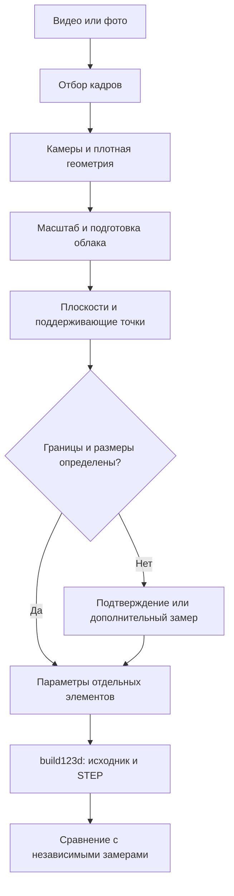

# Конвейер: от изображений к редактируемой модели

Основной маршрут первого опыта выбран. Ниже — назначение этапов и передаваемые данные, а не уже проверенный установочный рецепт. Версии и реальные команды записываются в [карточке запуска](../templates/run-record.md).

## 1. Видео → кадры

Штатный узел Meshroom **KeyframeSelection** отбирает кадры из видео. Для фотографий этот этап пропускается. Важны чёткость и изменение точки съёмки, а не максимальное число почти одинаковых кадров. [S01]

Выход — отобранные изображения и их связь с источником. Способ подключения к следующему узлу зависит от версии Meshroom/AliceVision: старые инструкции с ручным реимпортом не следует автоматически переносить на новые графы. Это проверяется при подготовке runtime.

## 2. Кадры → камеры и плотная геометрия

**SfM** находит соответствия деталей между снимками, оценивает камеры и разреженную структуру. **MVS** по согласованным камерам восстанавливает более подробную геометрию, в том числе карты глубины. Этим занимается штатный граф AliceVision внутри Meshroom. [S02–S04]

Для стандартного CUDA-этапа DepthMap нужна совместимая NVIDIA. Это требование выбранной реализации, а не утверждение, что вся фотограмметрия вообще невозможна на CPU. CPU draft не равноценен плотному этапу. [S02]

Плотное облако можно получить через выход **Dense SfMData узла Meshing** и преобразовать в PLY узлом **ConvertSfMFormat**. Старое руководство показывает `densePointCloud.abc`; в новых исходниках встречается `densePointCloud.usda`. Не используем расширение файла как вечный контракт. Фиксируем путь и возможности экспорта установленной версии. [S03–S04]

Созданная попутно сетка допустима. Текстурирование для получения инженерной геометрии не требуется. Сохраняем также камеры и отобранные кадры: downstream-обработка не должна терять возможность свериться с изображениями.

## 3. Масштаб, координаты и подготовка

Одно известное расстояние позволяет задать общий масштаб согласованной монокулярной реконструкции. Оно не исправляет локальные деформации. Ориентация осей и географическая привязка — отдельные операции. CCTag помогают узнавать опорные точки; их номера не содержат физических размеров. [S05–S06]

Масштаб можно применять к согласованным SfM-данным штатным **SfMTransform** до последующих вычислений, а не обязательно в конце. Если преобразование сделано позднее, оно должно быть одинаково учтено для облака, камер и CAD. Записываем единицы и преобразование один раз; повторное масштабирование недопустимо.

В CloudCompare обрезаем сцену до объекта, удаляем явные выбросы, при необходимости прореживаем и оцениваем нормали. Сохраняем исходную реконструкцию отдельно от обработанной: агрессивное сглаживание может стереть тонкие детали и края. Фильтры выбираем по наблюдаемой проблеме. [S07]

## 4. Облако → плоскости

Плагин **qRANSAC_SD** выделяет геометрические примитивы и соответствующие им точки; в CLI предусмотрена команда **-RANSAC**. Плагин должен входить в установленную сборку. Сам факт наличия CloudCompare этого не гарантирует. [S07–S08]

Для первого объекта используем плоскости. Выход этого шага — параметры поверхностей и группы поддерживающих точек. Порог подгонки задаётся в единицах уже известного масштаба. Его нельзя интерпретировать как доказанную точность съёмки.

Практическую передачу аналитических параметров и сегментов из выбранной сборки в следующий этап ещё нужно проверить. Не обещаем существование готового автоматического экспорта «стойки в JSON».

## 5. Поверхности → конечные детали и параметры

**Здесь находится главная интеграционная неопределённость пилота.** Плоскость математически бесконечна; она не сообщает длину доски, границы проёма или невидимую толщину.

Необходимо определить, какие поверхности принадлежат одной детали, где проходят реальные края и какими данными подтверждены размеры. Пересечения подходящих плоскостей дают кандидаты рёбер и углов, но их ещё нужно ограничить наблюдаемыми контурами. Отсутствие точек может означать и проём, и окклюзию; автоматически закрывать его нельзя.

Первый проход допускает выделение области и подтверждение групп/границ человеком. Небольшой скрипт может передать параметры и вычислить согласованные пересечения. Разработка большого распознавателя архитектуры не входит в начальный план.

Для каждой детали достаточно явно записать:

- идентификатор и тип представления: например, призматический элемент;
- положение и ориентацию, сечение, длину или фактический ограничивающий контур;
- единицы и ссылку на поддерживающие поверхности/участок облака;
- происхождение каждого спорного параметра: вычислен, измерен вручную, подтверждён или предположен;
- намеренно введённые ограничения: прямоугольность, параллельность, одинаковые сечения.

До первого прохода это смысловой контракт, а не обязательная большая схема данных. LLM управляет инструментами и пишет CAD-код; метрические вычисления выполняются геометрическими средствами.

## 6. Параметры → build123d → CAD

Строим **новую понятную модель по измерениям**, не угадываем исходную историю проектирования. Простое сечение и выдавливание подходят там, где такой объект согласуется с наблюдаемыми данными. Неидеальный элемент не следует автоматически превращать в идеальный брусок.

build123d использует OpenCascade и предоставляет операции построения и STEP-экспорта. Сохраняем Python-исходник с параметрами и STEP. Полигональный preview можно передать в Blender, но он не заменяет инженерную геометрию. [S09]

STEP переносит геометрию; он не обещает восстановление дерева операций build123d в произвольном CAD-редакторе. Для изменения размеров сохраняется исходник модели.

## 7. Проверка результата

Геометрическое ядро проверяет корректность тел, затем выполняется повторное открытие STEP. Для сборки ожидается обоснованное число отдельных тел; проверку старой одиночной детали «ровно одно тело» копировать нельзя.

Отдельно сравниваем независимые контрольные расстояния и важные проёмы. Геометрически валидный CAD может иметь неправильные размеры. Отчёт содержит фактические ошибки, ненаблюдавшиеся участки, ручные действия и расход ресурсов. До согласования допуска можно сообщить отклонения, но нельзя объявить производственную пригодность.

Список первоисточников: [S01–S09](sources.md). Подробные команды фиксируются только после проверки выбранной сборки.
