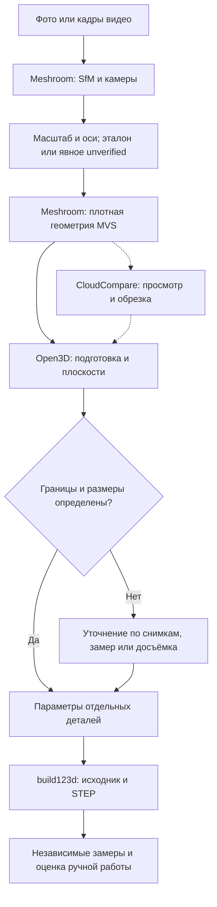

# Конвейер: от изображений к редактируемой модели

Текущий [Goal #8](goal-8.md) относится к фотограмметрической части: облако,
отдельная raw mesh и связанные native выходы. Mesh уже прочитан из принятого
backup, а полный граф сохраняется для --toNode продолжения. [Карта сценариев](meshroom-modes.md)
и [выдача mesh/оси](reports/2026-11-22/meshroom-harness.md) различают выполненное
чтение, native планирование и ещё не исполненные фильтрацию/текстуры.

Рабочий маршрут: **фото/видео → Meshroom/AliceVision → плотное облако → Open3D → подтверждённые параметры → build123d**. На закреплённой Meshroom 2026 завершён [Goal #6](goal-6.md): настоящее видео прошло native regular отбор до 37 кадров, оба графа зарегистрировали 37/37 камер и дали плотное PLY. Для базовой съёмки выбран Standard, Legacy сохранён для CCTag3/fallback. Команды — в [runbook](runbook.md), фактические результаты и границы — в [отчёте](reports/2026-11-21/photo-video-3d.md). Физический масштаб неизвестен; детали и CAD — отдельный следующий этап.

Исторический [Goal #4](goal-4.md) проверил отдельные Dice/synthetic участки до исходника и STEP: [модели](../examples/goal-4/README.md), [отчёт](reports/2026-11-21/meshroom-2026.md). [Отчёт Goal #2](reports/2026-11-21/technical-run.md) и [модели](../examples/goal-2/README.md) также сохраняются. Эти опыты не доказывают восстановление целого объекта или точность новой съёмки. CloudCompare помогает посмотреть и обрезать облако.

## 1. Изображения

Для новой съёмки подходят резкие фотографии в исходном разрешении или видео неподвижного объекта с изменением точки съёмки. Фото убирают этап извлечения кадров, но не гарантируют отсутствие смаза или сжатия. Реальный видеовход до плотной геометрии проверен в Goal #6; видео → CAD и точность собственной съёмки ещё не проверены.

Для видео используем штатный **KeyframeSelection**; реально проверен regular отбор. Smart selection по sharpness/flow изучен, но его полный запуск не квалифицирован. Просматриваем траекторию, резкость и перекрытие до MVS, сохраняем исходное видео и связь выбранных кадров с источником. Отдельный ранжировщик на OpenCV заранее не пишем. [S01](sources.md)

## 2. Камеры и плотная геометрия

**SfM** оценивает камеры и разреженную структуру по соответствиям между снимками. **MVS** восстанавливает более подробную геометрию по согласованным видам. Используем штатный граф AliceVision внутри Meshroom; для выбранного плотного этапа DepthMap нужна совместимая NVIDIA. CPU draft не заменяет его. [S02–S04](sources.md)

Исправленная база 2023.3 / AliceVision 3.2 с `densePointCloud.abc` сохранена [в Git f317](https://github.com/Kwentin3/photogrammetry-to-cad/blob/f3173b3fdfe27f7e760b84e23f6845b11a937b65/docs/runbook.md). Основная 2026 закреплена на Meshroom `b12ea8896e7e95cc9911b4ec39c272914e4da726` / AliceVision `d012d05589b528dcf57a2a0c805c0a5709df8613`. Standard использует новый SfM DAG и ExportImages без PDS adapter; Legacy сохраняет прежнюю SfM/MVS-топологию с PrepareDenseScene и служит маршрутом CCTag3/fallback. Граф/aliases/UID принадлежат штатному API. Dense SfMData — `densePointCloud.usda` с соседним `*_landmarks.usdc`; экспорт PLY выполняет native **ConvertSfMFormat**, не ручной разбор raw USD. JSON получает фактические describers; dense PLY — `unknown` и отключённые camera exports. Сохраняем полный UID-каталог и source SHA. Текстурирование не требуется. [S16, S22–S23](sources.md)

В историческом Goal #4 для Dice применялась штатная белая HSV-маска до FeatureExtraction и повторно в PrepareDenseScene; в synthetic — серая маска фона на плотном этапе. Эти конкретные native прогоны не квалифицируют произвольный masked Standard или все режимы. Общая подготовка готовых масок проверяется локально; настройки и ограничения — в [runbook](runbook.md). Автосегментация, turntable и две стороны не входят в фактически проверенный общий путь.

Сохраняем камеры, исходные кадры и необработанную плотную геометрию: они нужны для проверки границ и происхождения размеров.

У Legacy 2026 наблюдалось нулевое число PDS chunks: SUCCESS мог оставить 0 EXR.
Тонкий `prepare_dense_images.py` использует native Graph/NodeChunk/
buildCommandLine/runtimeEnv для whole-scene запуска; native статус не подделывается.
В Goal #6 Standard не потребовал adapter, Legacy потребовал один явный вызов.
Перед DepthMap проверяются все EXR, viewID, alpha и соответствующие producer metadata.
Патча ядра нет; adapter удаляется после проверенного исправления native chunk
planning на следующем pin. Все Linux Python-команды после env — bundled3.11.

Успешные узлы и полная регистрация камер не гарантируют покрытие объекта.
Просматриваем несколько направлений облака рядом с исходными кадрами, описываем
восстановленные видимые поверхности, края, разрывы и лишнюю геометрию. Для этого
не назначаем универсальный порог числа точек. Скрытые стороны и физическая
точность требуют иных данных и независимых замеров.

## 3. Масштаб и система координат

По умолчанию `scale.mode=unknown`: координаты имеют произвольные SfM units и не считаются физическими миллиметрами. Одно измеренное расстояние задаёт общий масштаб связной монокулярной реконструкции, но не исправляет локальную деформацию. CCTag помогают опознавать точки, их ID не кодирует физические размеры. Для измеренной базы общий путь требует Legacy и CCTag3, сохраняет источник замера и применяет scalar **SfMTransform** **до плотного расчёта**. CCTag ID encoding нового Standard DAG пока не квалифицирован. [S05–S06, S18, S22–S23](sources.md)

В историческом from_markers опыте Goal #4 штатный Graph API связал transform с PDS; downstream aliases распространили источник на dense-входы. Подтверждение переноса — native inputLink/UID, реальные commandLine и SHA USDA/USDC. Этот отдельно проверенный маршрут с полными координатами не является готовой общей настройкой `marker_coords`: общий adapter её отвергает. Старый сериализованный ABC-адаптер относится к рецепту 2023.3.

Известная база 100 мм проверена только на синтетическом дополнении. Для реальных тестовых фото без независимого замера масштаб остаётся `unverified`; количество поз и обнаружение меток не меняют этот статус.

Goal #6 дополнительно проверил native scalar на синтетическом SfM: известный
отрезок численно переведён в 100 единиц с сохранением uniform scale. Локальные
тесты обвязки и этот native probe не являются проверкой измеренной базы на реальном
видео или оценкой физической точности. У нового видео сохранён `unknown` scale.

Миллиметры задаёт приложение: synthetic target −50/+50 означает numeric baseline
100, далее native PLY → Open3D `meters_per_unit=0.001` → CAD мм. AV USD IO не
пишет/не читает stage units; raw USD также меняет оси хранения. Native JSON/PLY
восстанавливает соглашения AliceVision, поэтому не масштабируем/не переориентируем
координаты ручным USD-parser или generic viewer.

Отдельно выбираем удобное начало, например у основания левой стойки, и правые ортонормированные оси. Записываем, по каким наблюдениям они построены. Если направление взято по опорной стойке, называем его условным направлением: сама стойка может быть наклонной. Измеренная вертикаль требует независимого основания, например уровня.

Перенос и поворот применяются ко всей сцене и сохраняют взаимные углы элементов. Прямоугольность и одинаковые сечения не вводятся автоматически. Для облака, камер и CAD действует одно согласованное преобразование и явно указанные единицы; повторного масштабирования быть не должно.

## 4. Подготовка облака и плоскости

**Open3D** — вычислительный компонент на CPU. `scripts/extract_plane.py` использует native `segment_plane`, явный ROI и единицы; сохраняет поддерживающие точки, параметры и подписанный SVG. Численные операции NumPy/SciPy закреплены в зависимостях; это не отдельный распознаватель. **CloudCompare** — просмотр и при необходимости ручная обрезка. Его `-RANSAC`, headless-запуск и экспорт коэффициентов не являются обязательными стыками пилота. [S07–S08, S13](sources.md)

Штатный `segment_plane` возвращает коэффициенты `(a, b, c, d)` и индексы поддерживающих точек. При необходимости повторяем подгонку на оставшихся или выделенных областях. Это оценки по данным, а не точные границы: одна плоскость может объединить несвязанные поверхности разных деталей. [S13](sources.md)

Передаём дальше коэффициенты, поддерживающий сегмент и его выпуклый контур в `planar-extrusion-v1` JSON, который читает `build_cad.py`. Это узкий контракт одной области; Open3D не обещает готовую отдельную деталь. Порог RANSAC задаём в известных единицах и не принимаем его за измеренную точность съёмки. Исходное облако сохраняем, фильтры применяем под видимый дефект, чтобы не стереть тонкие края.

## 5. Поверхности → конечные детали

**Это остаётся главным ограничением обобщения пилота.** Проверена одна выбранная выпуклая плоская область, а не автоматическая сборка всех деталей. Нужно определить принадлежность поверхностей, реальные края и доступные размеры. Пересечения плоскостей дают кандидаты рёбер; конечные границы проверяются по облаку и снимкам. Отсутствие точек может означать проём или невидимую поверхность — заполнять его автоматически нельзя.

Агент рассчитывает доступное, затем показывает только спорные места: фотографию или вид облака с ID деталей и короткий вопрос. Несколько видов добавляются, если один не объясняет неоднозначность. Ручной замер скрытой толщины допустим и записывается отдельно. Полная ручная разметка каждой плоскости не требуется.

Минимальные данные детали: идентификатор, положение и ориентация, сечение и длина либо ограничивающий контур, единицы, связь с сегментами и происхождение параметров. Прямоугольность, параллельность и другие намеренно введённые ограничения отмечаем явно. Универсальную схему данных и распознаватель архитектуры до опыта не строим.

Мультимодальный агент может сопоставлять изображения и формулировать вопросы. Метрические расчёты остаются за геометрией и замерами. SAM 2, перенос масок в 3D и замена сопоставления признаков — [резерв под конкретную проблему](../research/README.md), а не новые обязательные этапы.

## 6. Параметры → CAD

`scripts/build_cad.py` использует build123d/OpenCascade и требует явного решения о толщине: `human`, `measured` или техническое `test_assumption`; `unresolved` блокирует построение. На новых облаках 2026 сохранены параметры, самодостаточный `model.py`, STEP, изменённая и standalone-пересборка. Read-back подтвердил по одному валидному телу, положение/наклон/контур/bounds; изменение только толщины даёт объём ×2.5. Dice имеет условные CAD мм, synthetic переносит базу 100 мм до CAD frame и STEP с миллиметровой единицей. Материалы — в [examples/goal-4](../examples/goal-4/README.md), сравнение с Goal #2 — в [отчёте](reports/2026-11-21/meshroom-2026.md). Это не восстановление скрытой поверхности или физической точности Dice. Экспорт STEP не переносит Python-программу в произвольный CAD. [S09](sources.md)

Проверяем тела, структуру сборки, проём, повторное открытие STEP и изменение одного параметра с пересборкой. Затем сравниваем независимые ширину, высоту, обе диагонали и доступные сечения. Валидность тела и точность размеров — разные проверки. Фактические ошибки, допущения, ручные действия и расходы записываем в одну карточку; без согласованного допуска пригодность к изготовлению не заявляем.
