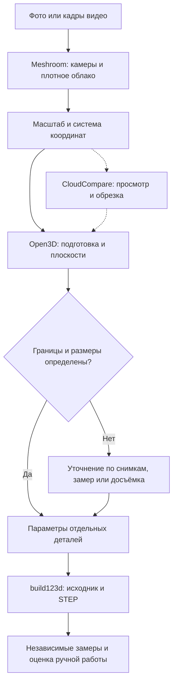

# Конвейер: от изображений к редактируемой модели

Рабочий маршрут: **фото/видео → Meshroom/AliceVision → плотное облако → Open3D → подтверждённые параметры → build123d**. CloudCompare помогает посмотреть и обрезать облако. Это согласованный план, ещё не проверенная интеграция; реальные версии и команды попадут в [карточку запуска](../templates/run-record.md).

## 1. Изображения

Для первого прохода предпочитаем резкие фотографии в исходном разрешении. Это убирает этап извлечения кадров, но не гарантирует отсутствие смаза или сжатия. Видео остаётся поддерживаемым входом; проверка удобства видеосъёмки — последующий продуктовый шаг, а не обязательный второй конвейер.

Для видео сначала используем штатный **KeyframeSelection**: важны чёткость и изменение точки съёмки. Если его подключение в выбранной версии мешает, резерв — извлечь кадры через **ffmpeg** и отобрать пригодные. Отдельный ранжировщик на OpenCV заранее не пишем. Сохраняем связь кадров с источником. [S01](sources.md)

## 2. Камеры и плотная геометрия

**SfM** оценивает камеры и разреженную структуру по соответствиям между снимками. **MVS** восстанавливает более подробную геометрию по согласованным видам. Используем штатный граф AliceVision внутри Meshroom; для выбранного плотного этапа DepthMap нужна совместимая NVIDIA. CPU draft не заменяет его. [S02–S04](sources.md)

Плотный результат получаем через **Dense SfMData узла Meshing** и экспортируем в PLY через **ConvertSfMFormat**. В старом руководстве вход называется `densePointCloud.abc`, в новых исходниках встречается `.usda`; реальный выход фиксируем по установленной версии. Промежуточная сетка допустима, текстурирование для этого опыта не требуется. [S03–S04](sources.md)

Сохраняем камеры, исходные кадры и необработанную плотную геометрию: они нужны для проверки границ и происхождения размеров.

## 3. Масштаб и система координат

Одно измеренное расстояние задаёт общий масштаб связной монокулярной реконструкции. Оно не исправляет локальную деформацию. CCTag помогают опознавать точки, но их ID не кодирует физические размеры. Штатный **SfMTransform** работает с согласованными SfM-данными; точный граф проверяем на выбранной версии. [S05–S06](sources.md)

Отдельно выбираем удобное начало, например у основания левой стойки, и правые ортонормированные оси. Записываем, по каким наблюдениям они построены. Если направление взято по опорной стойке, называем его условным направлением: сама стойка может быть наклонной. Измеренная вертикаль требует независимого основания, например уровня.

Перенос и поворот применяются ко всей сцене и сохраняют взаимные углы элементов. Прямоугольность и одинаковые сечения не вводятся автоматически. Для облака, камер и CAD действует одно согласованное преобразование и явно указанные единицы; повторного масштабирования быть не должно.

## 4. Подготовка облака и плоскости

**Open3D** — вычислительный компонент на CPU. Используем готовые операции библиотеки для необходимых фильтров и подгонки плоскостей; небольшой Python-скрипт связывает их с параметрами модели. NumPy допустим для численных операций, отдельная зависимость от SciPy заранее не нужна. **CloudCompare** — просмотр и при необходимости ручная обрезка. Его `-RANSAC`, headless-запуск и экспорт коэффициентов не являются обязательными стыками пилота. [S07–S08, S13](sources.md)

Штатный `segment_plane` возвращает коэффициенты `(a, b, c, d)` и индексы поддерживающих точек. При необходимости повторяем подгонку на оставшихся или выделенных областях. Это оценки по данным, а не точные границы: одна плоскость может объединить несвязанные поверхности разных деталей. [S13](sources.md)

Передаём дальше коэффициенты и поддерживающие сегменты. JSON добавляем только как простой файл обмена, когда его читает следующий шаг; Open3D не обещает готовые контуры деталей в этом формате. Порог RANSAC задаём в известных единицах и не принимаем его за измеренную точность съёмки. Исходное облако сохраняем, фильтры применяем под видимый дефект, чтобы не стереть тонкие края.

## 5. Поверхности → конечные детали

**Это главная непроверенная часть опыта.** Нужно определить принадлежность поверхностей, реальные края и доступные размеры. Пересечения плоскостей дают кандидаты рёбер; конечные границы проверяются по облаку и снимкам. Отсутствие точек может означать проём или невидимую поверхность — заполнять его автоматически нельзя.

Агент рассчитывает доступное, затем показывает только спорные места: фотографию или вид облака с ID деталей и короткий вопрос. Несколько видов добавляются, если один не объясняет неоднозначность. Ручной замер скрытой толщины допустим и записывается отдельно. Полная ручная разметка каждой плоскости не требуется.

Минимальные данные детали: идентификатор, положение и ориентация, сечение и длина либо ограничивающий контур, единицы, связь с сегментами и происхождение параметров. Прямоугольность, параллельность и другие намеренно введённые ограничения отмечаем явно. Универсальную схему данных и распознаватель архитектуры до опыта не строим.

Мультимодальный агент может сопоставлять изображения и формулировать вопросы. Метрические расчёты остаются за геометрией и замерами. SAM 2, перенос масок в 3D и замена сопоставления признаков — [резерв под конкретную проблему](../research/README.md), а не новые обязательные этапы.

## 6. Параметры → CAD

build123d/OpenCascade строит новую модель по измерениям. Простое сечение и выдавливание используем там, где они согласуются с данными. Сохраняем Python-исходник с параметрами и STEP; экспорт STEP не переносит Python-программу построения в произвольный CAD. Полигональный preview для Blender остаётся отдельным представлением. [S09](sources.md)

Проверяем тела, структуру сборки, проём, повторное открытие STEP и изменение одного параметра с пересборкой. Затем сравниваем независимые ширину, высоту, обе диагонали и доступные сечения. Валидность тела и точность размеров — разные проверки. Фактические ошибки, допущения, ручные действия и расходы записываем в одну карточку; без согласованного допуска пригодность к изготовлению не заявляем.
