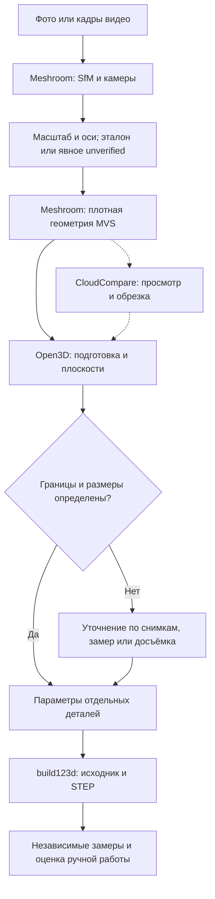

# Конвейер: от изображений к редактируемой модели

Рабочий маршрут: **фото/видео → Meshroom/AliceVision → плотное облако → Open3D → подтверждённые параметры → build123d**. Для реальных Dice-фото и синтетического дополнения выполнены native SfM/MVS, выгрузка, освобождение GPU и локальные прогоны до исходника/STEP. Ограничения результатов — в [техническом отчёте](reports/2026-11-21/technical-run.md); окончательная приёмка и поставка — только в [Goal #2](goal-2.md). Команды — в [runbook](runbook.md). CloudCompare помогает посмотреть и обрезать облако.

## 1. Изображения

Для первого прохода предпочитаем резкие фотографии в исходном разрешении. Это убирает этап извлечения кадров, но не гарантирует отсутствие смаза или сжатия. Видео остаётся поддерживаемым входом; проверка удобства видеосъёмки — последующий продуктовый шаг, а не обязательный второй конвейер.

Для видео сначала используем штатный **KeyframeSelection**: важны чёткость и изменение точки съёмки. Если его подключение в выбранной версии мешает, резерв — извлечь кадры через **ffmpeg** и отобрать пригодные. Отдельный ранжировщик на OpenCV заранее не пишем. Сохраняем связь кадров с источником. [S01](sources.md)

## 2. Камеры и плотная геометрия

**SfM** оценивает камеры и разреженную структуру по соответствиям между снимками. **MVS** восстанавливает более подробную геометрию по согласованным видам. Используем штатный граф AliceVision внутри Meshroom; для выбранного плотного этапа DepthMap нужна совместимая NVIDIA. CPU draft не заменяет его. [S02–S04](sources.md)

Пилот закреплён на Meshroom 2023.3.0 / AliceVision 3.2.0: **Dense SfMData узла Meshing** — `densePointCloud.abc`, экспорт PLY выполняет **ConvertSfMFormat**. Форматы новых версий не подставляем в этот рецепт. Промежуточная сетка допустима, текстурирование не требуется. [S03–S04, S16](sources.md)

Для Dice применяется штатная белая HSV-маска до FeatureExtraction и повторно в PrepareDenseScene. Маска зависит от CameraInit, не SfM, поэтому цикла нет; используется новый masked SfM/кэш. В синтетическом дополнении серая маска фона применяется только на плотном этапе. Проверяются маски по VIEW_ID, размер и alpha EXR, а не только завершение узла. Старый unmasked Dice и диагностические helper-варианты не подменяют принятый профиль.

Сохраняем камеры, исходные кадры и необработанную плотную геометрию: они нужны для проверки границ и происхождения размеров.

## 3. Масштаб и система координат

Одно измеренное расстояние задаёт общий масштаб связной монокулярной реконструкции. Оно не исправляет локальную деформацию. CCTag помогают опознавать точки, но их ID не кодирует физические размеры. Штатный **SfMTransform** преобразует SfM **до плотного расчёта**. Адаптер загружает четыре dense-входа как native template; подтверждение переноса — новые UID, фактические commandLine и неизменный SHA исходного преобразованного ABC. [S05–S06, S18](sources.md)

Известная база 100 мм проверена только на синтетическом дополнении. Для реальных тестовых фото без независимого замера масштаб остаётся `unverified`; количество поз и обнаружение меток не меняют этот статус.

Отдельно выбираем удобное начало, например у основания левой стойки, и правые ортонормированные оси. Записываем, по каким наблюдениям они построены. Если направление взято по опорной стойке, называем его условным направлением: сама стойка может быть наклонной. Измеренная вертикаль требует независимого основания, например уровня.

Перенос и поворот применяются ко всей сцене и сохраняют взаимные углы элементов. Прямоугольность и одинаковые сечения не вводятся автоматически. Для облака, камер и CAD действует одно согласованное преобразование и явно указанные единицы; повторного масштабирования быть не должно.

## 4. Подготовка облака и плоскости

**Open3D** — вычислительный компонент на CPU. `scripts/extract_plane.py` использует native `segment_plane`, явный ROI и единицы; сохраняет поддерживающие точки, параметры и подписанный SVG. Численные операции NumPy/SciPy закреплены в зависимостях; это не отдельный распознаватель. **CloudCompare** — просмотр и при необходимости ручная обрезка. Его `-RANSAC`, headless-запуск и экспорт коэффициентов не являются обязательными стыками пилота. [S07–S08, S13](sources.md)

Штатный `segment_plane` возвращает коэффициенты `(a, b, c, d)` и индексы поддерживающих точек. При необходимости повторяем подгонку на оставшихся или выделенных областях. Это оценки по данным, а не точные границы: одна плоскость может объединить несвязанные поверхности разных деталей. [S13](sources.md)

Передаём дальше коэффициенты, поддерживающий сегмент и его выпуклый контур в `planar-extrusion-v1` JSON, который читает `build_cad.py`. Это узкий контракт одной области; Open3D не обещает готовую отдельную деталь. Порог RANSAC задаём в известных единицах и не принимаем его за измеренную точность съёмки. Исходное облако сохраняем, фильтры применяем под видимый дефект, чтобы не стереть тонкие края.

## 5. Поверхности → конечные детали

**Это остаётся главным ограничением обобщения пилота.** Проверена одна выбранная выпуклая плоская область, а не автоматическая сборка всех деталей. Нужно определить принадлежность поверхностей, реальные края и доступные размеры. Пересечения плоскостей дают кандидаты рёбер; конечные границы проверяются по облаку и снимкам. Отсутствие точек может означать проём или невидимую поверхность — заполнять его автоматически нельзя.

Агент рассчитывает доступное, затем показывает только спорные места: фотографию или вид облака с ID деталей и короткий вопрос. Несколько видов добавляются, если один не объясняет неоднозначность. Ручной замер скрытой толщины допустим и записывается отдельно. Полная ручная разметка каждой плоскости не требуется.

Минимальные данные детали: идентификатор, положение и ориентация, сечение и длина либо ограничивающий контур, единицы, связь с сегментами и происхождение параметров. Прямоугольность, параллельность и другие намеренно введённые ограничения отмечаем явно. Универсальную схему данных и распознаватель архитектуры до опыта не строим.

Мультимодальный агент может сопоставлять изображения и формулировать вопросы. Метрические расчёты остаются за геометрией и замерами. SAM 2, перенос масок в 3D и замена сопоставления признаков — [резерв под конкретную проблему](../research/README.md), а не новые обязательные этапы.

## 6. Параметры → CAD

`scripts/build_cad.py` использует build123d/OpenCascade и требует явного решения о толщине: `human`, `measured` или техническое `test_assumption`; `unresolved` блокирует построение. Сохраняются самодостаточный `model.py`, STEP и inspection с повторным чтением, объёмом и положением. На фактических Dice/synthetic облаках этот переход и пересборка по изменению толщины выполнены: по одному валидному телу, объём ×2.5. Dice имеет только номинальные CAD единицы; synthetic сохраняет базу 100 мм и `SI_UNIT(.MILLI.,.METRE.)`. Это не восстановление скрытой поверхности или физической точности Dice. Экспорт STEP не переносит Python-программу в произвольный CAD. [S09](sources.md)

Проверяем тела, структуру сборки, проём, повторное открытие STEP и изменение одного параметра с пересборкой. Затем сравниваем независимые ширину, высоту, обе диагонали и доступные сечения. Валидность тела и точность размеров — разные проверки. Фактические ошибки, допущения, ручные действия и расходы записываем в одну карточку; без согласованного допуска пригодность к изготовлению не заявляем.
