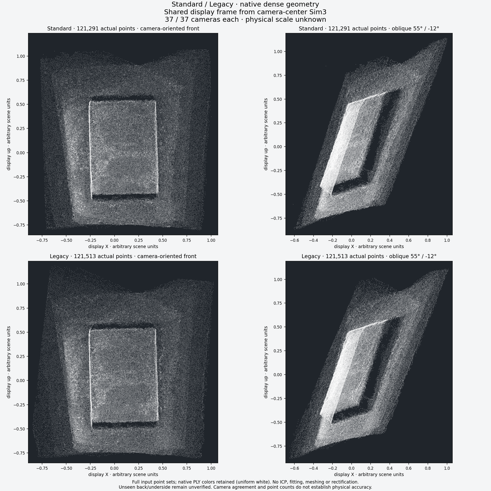

# Фото/видео → плотная геометрия: проверка Goal #6

Теперь новую подходящую съёмку можно передать через JSON и manifest, получить
native проект, плотное PLY и отчёт с камерами, bbox и происхождением масштаба.
Одно настоящее видео вне Dice/CCTag/synthetic прошло от исходного MOV через
37 выбранных кадров до двух независимых плотных реконструкций. Для базового
фото/видео выбран **Standard**; Legacy сохраняется для CCTag и как запасной путь.
Команды — в [runbook](../../runbook.md), границы режимов — в
[матрице](../../meshroom-modes.md), общая приёмка — в [Goal #6](../../goal-6.md).
Числа, хэши и пути внутри сохранённого комплекта — в
[машиночитаемом снимке](photo-video-results.json).

**Снимок 21 ноября 2026 года: реконструкция и сохранение проверены, GPU удалена.**
Независимая окончательная приёмка и публикация учитываются в рабочей записи Goal.
Этот отчёт не подтверждает CAD, физическую точность или пригодность для изготовления.

## Материал и воспроизводимость

Использован [Google Objectron](https://github.com/google-research-datasets/Objectron),
`cereal_box/batch-1/1`: [исходный MOV](https://storage.googleapis.com/objectron/videos/cereal_box/batch-1/1/video.MOV),
16 930 901 байт, 1920×1440, 220 кадров, около 7.33 с. Это реальная неподвижная
коробка на полу, снятая движущейся камерой. Источник не собран из фотографий.
Перед расчётом просмотрены 12 кадров всей траектории: лицевая сторона видна
непрерывно, при обходе меняется видимая боковина, перекрытие высокое.

Лицензия данных — [Computational Use of Data Agreement 1.0](https://github.com/google-research-datasets/Objectron/blob/master/LICENSE).
Исходные данные используются для вычислительной обработки; их передача требует
соблюдения условий C-UDA и сохранения атрибуции Google Objectron. Данные, кэши,
полные журналы и приватные пути в Git не включены.

MOV скачан четырьмя HTTP ranges: проверены длины, Content-Range и серверный MD5
`3c8082ef333a15e0bc8b5b6a9718f4f1`. SHA256 исходника:
`d6867cae26f61b3d2cef41dde53266f2f7aed673dae7c3955c4de8752d605f77`.
Native KeyframeSelection в regular mode выбрал **37** кадров. Seal сверил SHA
ролика, сохранённый проект, native views и фактические файлы. Manifest выбранных
кадров SHA256:
`6c84267d24a42b29a2b2f24498cb126225b57a6ce34428dc7a188498d7ccd690`.
Имена сохраняют zero-based source indices; временные интервалы ролика переменные,
поэтому timestamps не вычислялись делением индекса на номинальный fps.

Оба графа получили этот же manifest без изменения общего кода под объект или
число кадров. Запуски выполнены на RTX 3090 в закреплённом комплекте:
Meshroom `b12ea8896e7e95cc9911b4ec39c272914e4da726`, AliceVision
`d012d05589b528dcf57a2a0c805c0a5709df8613`; archive SHA256
`4ca3cfb0898b8000def4e68d513468a199b948329b63cdb6b257e427d295163b`.
Инвентаризация полного архива: 12486 записей, 27 шаблонов и 112 Python-файлов
AliceVision, включая вспомогательные файлы. Это не число исполняемых узлов.

## Сопоставление графов

Фактические effective settings и native command lines сверены: CPU 8,
DSPSIFT normal/normal, ImageMatching Exhaustive, DepthMap downscale2/maxTCams10,
DepthMapFilter minNumOfConsistentCams3/nNearestCams10,
Meshing maxInputPoints10 000 000/maxPoints1 000 000. Маски не применялись;
измеренной базы у ролика нет, масштаб обоих результатов — **unknown**.

| Показатель | Standard | Legacy |
|---|---:|---:|
| Зарегистрированные камеры / входные | 37 / 37 | 37 / 37 |
| Конечные точки в экспортированном PLY | 121 291 | 121 513 |
| Неконечные точки | 0 | 0 |
| Проверенные dense EXR | 37 / 37 | 37 / 37 |
| Native dense-image producer | ExportImages | PrepareDenseScene |
| Явные вызовы whole-scene PDS adapter | 0 | 1 |
| Сумма elapsedTime native chunks, с | 604.806 | 547.455 |

Последняя строка — **не wall time и не длительность всего опыта**. Установка,
передачи, подготовка, проверки и отдельный Legacy whole-scene adapter в неё не
входят. По этим суммам нельзя объявлять один маршрут быстрее для пользователя.
Все записанные chunks завершились SUCCESS: 21 у Standard и 13 у Legacy.

PLY SHA256:

- Standard: `5f517556d87ccbc70459fe97a770fb199b6dec601deff5be601bd7b25538de2b`.
- Legacy: `b6935de90eb36ddf2af55877f59954152b5f40e0077cb2c8065c7e3fa2a97d3a`.

Оба PLY фактически прочитаны Open3D. Локальные JSON содержат долю камер,
точки/bbox, пустой список CCTag и явный неизвестный масштаб. Bbox относится к
собственной произвольной системе координат каждого SfM; сравнивать его числа
как физические размеры нельзя.

В обоих результатах видны крупная лицевая поверхность коробки и окружающий пол.
Похожи общий охват, полосы пропусков у основания/границ коробки и неполнота
периферии пола. На этих проекциях явного выигрыша одного графа в полноте нет.
Облака не замкнуты; задняя сторона и низ не восстановлены из отсутствующих видов.
Разница в 222 точки не является доказательством качества или точности.

Для общего отображения Legacy совмещён со Standard proper Sim3, вычисленным
только по центрам 37 общих native камер: scale≈0.51971962, det(R)≈1.
Это единое преобразование произвольных систем координат **только для просмотра**;
физический масштаб остаётся неизвестным. Исходные PLY не менялись. Виды используют
одинаковые пределы осей; показаны все точки, без ICP, подгонки плоскостей,
достройки или выпрямления. Native цвета обоих PLY равномерно белые — это просмотр
геометрии, не текстурированная модель. Согласование камер не заменяет независимый замер.

Standard выбран потому, что на этом материале он даёт сопоставимый наблюдаемый
результат штатным ExportImages без специального вызова PDS adapter. Это выбор
более простого рабочего маршрута, не утверждение превосходства по точности.
Legacy потребовал один явный вызов adapter, затем прошёл native compute;
последующая проверка подтвердила неизменность SHA всех dense EXR обоих графов.
Adapter сохраняется для Legacy/fallback, из Standard он не вызывается.

## Проверки изображений и исполнения

QA проверила фактические DepthMap input/imagesFolder, соответствие view IDs,
размеры, конечность RGBA, alpha и native metadata. Standard использует целевые
intrinsics ExportImages; PDS projection fields не приписывались этому producer.
У Standard `AliceVision:EV=-nan` оказался sentinel неизвестной экспозиции при
native Exposure=-1, partiallyDefined=false и evCorrection=false. EVComp=1
конечен, RGBA конечны; этот конкретный случай записан как unknown exposure.
Он не означает разрешения произвольных NaN в metadata или пикселях.

На реальном Linux проверены три случая владения процессами: orphan, timeout и
cancel. Во всех подтверждено завершение своих потомков, посторонний контрольный
процесс сохранился. Четыре проверки resume подтвердили повторное использование
успешного задания без повторного исполнения и отказ при отсутствующей или
неподтверждённой квитанции cleanup. Это проверка runner, а не доказательство
освобождения оплачиваемой аренды.

## Scalar scale: что именно проверено

Отдельный native GraphIO/CLI опыт SfMTransform завершился PASS примерно за
4.86 с на **историческом синтетическом SfM Goal #4**. Он проверяет передачу
скалярного коэффициента, не новый реальный замер рулеткой.

| Величина | Фактическое значение |
|---|---:|
| CCTag IDs и наблюдения | 0 и 1, по 10 наблюдений |
| Исходная реконструированная база | 0.4801067056395096 native units |
| Целевая база по явному соглашению | 100 мм |
| Scalar scale | 208.28703041503752 |
| База после native transform | 99.99999981184789 мм |
| Абсолютная численная ошибка / допуск | ≈1.8815×10⁻⁷ / 2×10⁻⁶ мм |

Проверены 4989 мировых точек и 10 поз: единое масштабирование, сохранённые
повороты камер, без дополнительного поворота или переноса сцены. Полные XYZ
меток не подставлялись вместо скалярного расстояния. Численная близость к 100
подтверждает native преобразование и соглашение о единицах; она не является
ошибкой фотограмметрии, физической базы или точностью в миллиметрах.

Общий маршрут требует Legacy для CCTag/измеренной базы: кодирование IDs в новом
Standard SfM DAG и после colorizing не квалифицировано, неподтверждённый режим
отвергается заранее. Marker_coords в общем adapter зарезервирован; полные XYZ
остаются отдельным историческим native from_markers рецептом с происхождением
координат. Виртуальные 100 мм не перенесены на Objectron.

## Ограничения и следующая съёмка

Видео даёт короткий обход преимущественно лицевой стороны; на печати есть блики,
на границах остаются пропуски. Для лучшего покрытия нужны резкие косые виды с
обеих сторон и с разных высот, достаточный параллакс и более равномерный свет.
Скрытая нижняя сторона требует отдельной съёмки; режим объединения двух сторон
в этом опыте не проверялся. Для физических размеров нужны реальная измеренная
база, независимые контрольные размеры и согласованный допуск.

Ручная подготовка этого опыта — выбор и просмотр ролика, native regular отбор,
две копии настроек и проверка результатов; ручных масок, размеров коробки,
ROI, подгонки формы или достройки не было. Это не измерение экономии ручного
труда на пользовательском объекте. Автосегментация, turntable и flip изучены
по файлам/источникам, но новым готовым режимом не объявлены.

## Сохранение и освобождение ресурсов

В постоянном хранилище владельца сохранён backup 1 611 819 183 байт, SHA256
`e3f6dba5ac76d221db866ff0b85d2ef6dd73332cd1e57c7403c1426863054c65`.
Проверены и распакованы 1102 payload-файла плюс индекс (1103 файла):
1 830 142 042 байта данных до упаковки, 12 ссылок USDA→USDC. Все SHA совпали,
USDC-заголовки сохранены, а scene/PLY совпадают с уже принятыми Open3D-артефактами.
Исходные USD были прочитаны native вычислениями/экспортом до упаковки; на Windows
проверено сохранение тех же байтов и соседних payloads, а не отдельный Linux runtime.

Первое скачивание уже имело 8 реальных SFTP sessions, но давало около 0.8 MiB/s.
Оно адресно остановлено с подтверждённым cleanup. Штатные `split` (64 MiB) и
rclone (8 файлов × 4 streams) дали около 2.45 MiB/s на активной фазе;
полная передача/сборка заняла 777 с со средней 1.98 MiB/s. Каждая из 25 частей
и затем общий архив проверены по SHA. Части и отменённый partial удалены после
приёмки, полный архив и распакованные результаты сохранены.

Нода удалена **21 ноября 2026, 19:12:29 UTC**; отсутствие своего ID проверено
полным списком провайдера. Native ledger именно этой аренды: **$0.248**,
включая GPU $0.209, диск $0.021 и трафик $0.018. Допуск владельца для #6:
до $0.60/ч, 4 часов от первой аренды и $25 всего. Диск после stop не оставлен.

Проверки исходников: **25 unittest PASS**, три Linux-проверки завершения native
отдельных сессий и четыре проверки resume PASS. Публикация и независимый вердикт
фиксируются отдельно в Goal; локальный технический успех ими не подменяется.

Подробные рабочие доказательства остаются вне Git: observations/standard и
observations/legacy содержат report.json, scene/PLY и QA; observations/shared —
frame-manifest и run-evidence.json; visualization — просмотр и его provenance.
Отчёт использует фактические артефакты, а окончательный статус ведётся в одной
[рабочей записи](../../goal-6.md).
