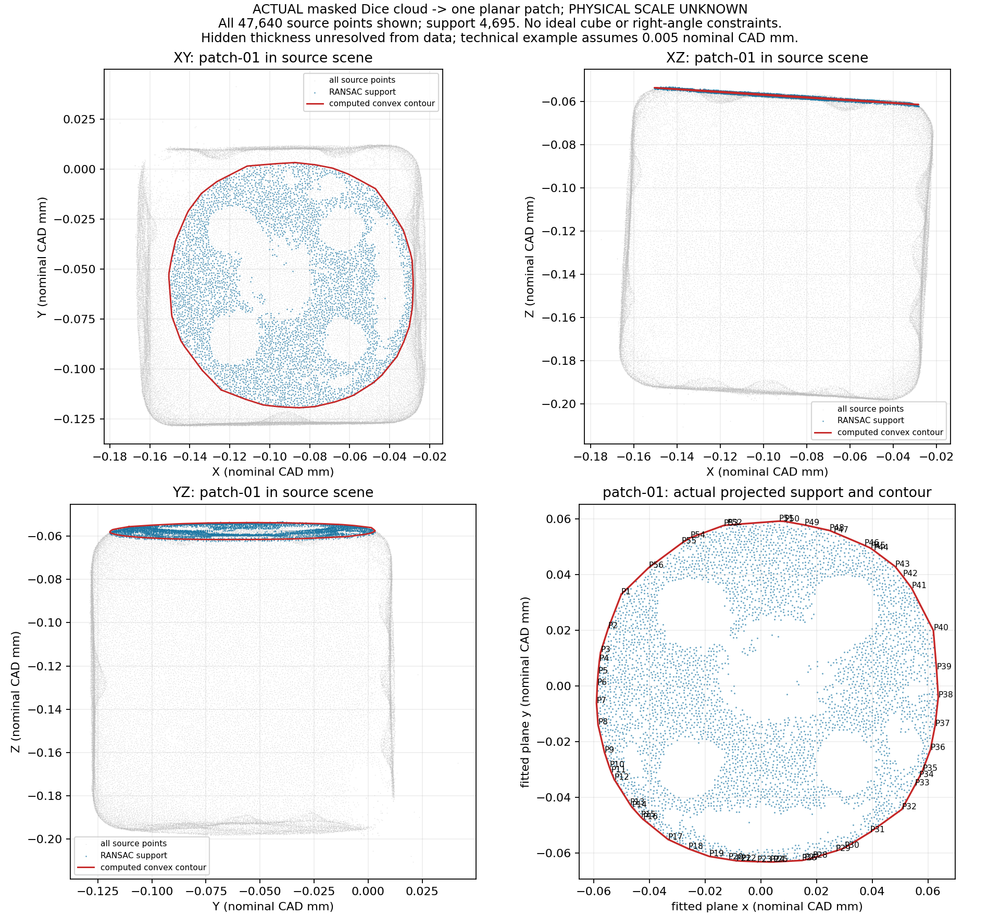

# Технический прогон фото → CAD, 21 ноября 2026

Выполнен маршрут Meshroom/AliceVision → Open3D → параметры → build123d/STEP
на реальных фотографиях. Отдельная известная виртуальная сцена доведена через
CCTag3/SfMTransform и MVS до CAD для проверки масштаба. Это техническая проверка
[Goal #2](https://github.com/Kwentin3/photogrammetry-to-cad/issues/2), не модель
беседки и не заключение о пригодности к изготовлению.

[Команды повторения](../../runbook.md), [комплект моделей](../../../examples/goal-2/README.md),
[текущее состояние задания](../../goal-2.md). Большие данные и исходные native
логи сохранены в рабочем каталоге `WORK` вне Git; публичные артефакты имеют
SHA256 источников. Контрольная сумма связывает наблюдаемые файлы, но не доказывает
их происхождение сама по себе.

## Материалы и окружение

| Материал | Закреплённый источник | Применение |
|---|---|---|
| 20 фотографий Dice, 47 086 536 байт | [alansartlog, photogrammetry-test-sets, commit 78e0a887](https://gitlab.com/photogrammetry-test-sets/dice-turntable-strong-lights-heavily-textured-w-watercolors/-/tree/78e0a887ba5263da66910fb4f4da0d9763e9177a), CC BY 4.0 | Основная реальная реконструкция и CAD участка грани |
| 50 фотографий CCTag, 74 304 634 байт | [Natowi, cctag-dataset, commit a04bedff](https://github.com/natowi/cctag-dataset/tree/a04bedff34800e876c08bf1e4a46699d4a6439db) — CC BY-SA 4.0 | Реальная идентификация и триангуляция меток |
| 10 синтетических pinhole-видов | `scripts/make_marker_fixture.py`, pinned CCTag bank в truth.json | Дополнительная известная шкала, плотная геометрия и CAD |

Dice: выбраны `01.JPG`…`20.JPG` из 33; оставшиеся не входят в принятый малый
набор (GitLab ответил 429 при дальнейшем скачивании). Исходные Git blob и SHA256
проверены downloader, manifests сохранены. Реальные фото CCTag не содержат
достоверного известного физического расстояния: оно не назначалось по изображению.

GPU: RTX 3090 24 ГБ, драйвер 595.91.07, Ubuntu 22.04/CUDA 11.8, образ
`nvidia/cuda@sha256:7c8e5ee1e8531f0d19f8d7e78c5b7efa9c455697fa96e62f083f361d6842e452`.
Наблюдаемый cgroup RAM limit 45 705 330 688 байт; OMP=8, один GPU job одновременно.
Официальный Meshroom 2023.3.0 / AliceVision 3.2.0; SHA256 архива
`92b81246356df3fd37ea08e1d09519392897aaa730843eb9fd4bd0582916d391` — измеренный
хэш скачанного официального релиза, не подпись издателя. Реально прошли native
CCTag3, SfMTransform и GPU DepthMap/MVS; наличия `nvidia-smi` недостаточно.

Локально: Windows x64, Python 3.11.9, Open3D 0.20.0, NumPy 2.4.6,
SciPy 1.17.1, build123d 0.13.0, Vast CLI 1.11.2. Полное окружение закреплено
в `requirements-lock-win-py311.txt`. Сохранённые synthetic PNG созданы Pillow
12.3.0; локальный lock содержит Pillow 12.2.0. Повторение по сохранённым кадрам
проверяемо; побайтовое совпадение вновь сгенерированных PNG разных версий не заявлено.

## Реальные фото → параметры → CAD

Первый Dice SfM/MVS успешно завершился, но облако содержало протяжённый фон
и не было принято как источник детали. Применены штатные HSV-маски белого фона
к FeatureExtraction и PrepareDenseScene (`mask-turntable-white.json`), отдельный
граф и кэш. Проверены все 20 масок по view ID/размерам, первая просмотрена.
Итог: 20 poses, **47 640 точек**, компактное тело, визуально согласующееся с кубиком.
SHA256 принятого PLY:
`8321d806d395f8d61ce9175bf527d87c2f63042602812cb9d3cda310bd6ffa86`.

По просмотренному облаку агент выбрал ROI верхней наблюдаемой поверхности
`[-0.175139, -0.129138, -0.074, -0.021294, 0.0414635, -0.05]`
в координатах источника. Open3D RANSAC с порогом 0.00075 и seed42:
11 729 точек ROI, 4 695 inliers; SciPy convex hull дал **56 вершин**.
Плоскость, положение и все вершины вычислены из этих точек; равенство сторон,
прямые углы и полный куб не задавались.

Физический масштаб **неизвестен**. Использовано тождественное представление
1 source unit = 1 **номинальный CAD мм** (`meters_per_unit=.001`, `unverified`).
Это не размер реального кубика. RMS подгонки 0.000406612 в тех же условных единицах,
не физическая погрешность.

[Подписанный вопрос](../../../examples/goal-2/real-dice/question.svg) относится к
толщине выбранного участка. `unresolved` действительно отклонён до экспорта.
Агент записал тестовое решение `.005` вдоль `+normal`, затем изменил только толщину
на `.0125`. Остальные поля JSON побайтово/структурно сохранены. Получены одно
валидное тело и повторно читаемый STEP в обоих случаях; объёмы
`6.083872498164e-5 → 1.520968124541e-4`, отношение **2.50000000000016**.
Самодостаточный model.py отдельно выполнен. Независимая проверка мировых границ
по вершинам source-derived контура и вектору экструзии дала ошибку <4.4e-13
номинального CAD мм.

Это центральный плоский участок, а не полная грань или кубик. Выпуклая экструзия
заполняет углубления шести пипсов и не восстанавливает округлённые кромки.
QA показывает и опору, и пропуски. Толщина не измерена и не подтверждена человеком.

## CCTag и известная шкала до CAD

Реальная съёмка Natowi: **50 восстановленных poses**. Уникальные ID0/1 — landmarks
1921/393, 5/7 posed observations, центры конечны. Расстояние
**1.4699492767 условных единиц**; общего наблюдаемого кадра у этой пары нет,
но они находятся в одной SfM-сцене. Два наблюдения проверены по native 2D-координатам
на исходных фото. ID2 имеет три 3D landmarks, ID5 — два; проверка всех ID правильно
отклоняет неоднозначность, выбранные 0/1 уникальны. Причина дублей не установлена.
Физический масштаб этой реальной сцены не доказан.

Дополнение с известным виртуальным размером: 10 перспективных изображений
карточки 320×240 мм, CCTag3 IDs0/1 на расстоянии 100 мм; Kfx=Kfy=1000 px,
1200×900, FOV61.92751306414704°. Банк радиусов pinned в truth; геометрия и камеры
сохранены. Native SfM восстановил 10 poses и по 10 observations каждой метки.
До преобразования baseline 0.4802920510; штатный `SfMTransform from_markers`
дал **100.0 мм**, коэффициент 208.2066521583.

Четыре фактических потребителя dense scene получили этот transformed ABC;
проверены их новые UID и emitted commandLine. Неверная чёрная маска отклонена:
фон fixture фактически серый 110/255. Native HSV-маска V=.42…44, только перед MVS,
не меняет уже восстановленную sparse сцену. Маски проверены по ID/размерам и фону.
Итоговый PLY: **15 884 точки**, 318.197×237.904×3.09944 мм, SHA256
`6b68c0ffb756fe66648cad5dea6618dee9f83d90d0f1b8a3e81eb5938949c269`.
Исходные 320×240 служат сравнением, не обрезкой или принудительным прямоугольником.

Этот же PLY прошёл Open3D: ROI охватывает все исходные точки, порог1 мм,
15 861 inliers, RMS0.130936 мм, **29 вершин**. Контур в локальной плоскости
237.904032×318.196898 мм. `meters_per_unit=.001` сохраняет 1 source unit = 1 мм;
известные центры меток в ортонормированном CAD-frame сохраняют расстояние **100.0 мм**.
STEP объявляет **SI_UNIT(.MILLI.,.METRE.)**; его мировые границы совпали с
независимо вычисленными границами source-derived контура и экструзии с ошибкой
<1.2e-11 мм. Тем самым проверены источник масштаба, единичное преобразование,
переданная геометрия и единицы экспорта, а не отдельно нарисованная тестовая деталь.

`unresolved` заблокирован, тестовая толщина 2→5 мм дала объёмы
150866.175319→377165.438297 мм³, отношение **2.49999999999986**; одно валидное тело,
STEP read-back и standalone model.py прошли. Это техническая виртуальная шкала,
не подтверждение точности реальной съёмки бумажных меток.

## Облачный цикл, продолжение и расходы

Создан один инстанс; ID и время начала записаны вне ноды/Git до установки.
Согласованные пределы: $0.60/ч, 4 часа, $25 вместе с диском/трафиком.
Выбрана ставка **$0.216667/ч** с диском60 ГБ.

`remote_job.sh` проверен на той же ноде: расчёт пережил разрыв SSH; дубль получил
exit75; resume успешной команды не повторил её; timeout остановил TERM-ignoring
потомка, проверка PGID не нашла живых участников. Каждый тяжёлый запуск имел свой
каталог, TTL, flock, логи и атомарный status. Native Meshroom cache использован
для продолжения существующих этапов; второй инстанс для продолжения не создавался.

После GPU скачаны графы, камеры, принятые/диагностические облака, логи, runtime
probes и нужные UID cache. Архив **1 387 366 260 байт**, SHA256
`69bbbb4f0d22f2a26050efe3874ed504737fb16110c0a6cee1250b67e495e5a7`.
Локально проверены полный хэш, распаковка 1 374 entries, JSON и хэши обоих PLY.
Исходные фотографии уже имели постоянную локальную копию. Runtime binary можно
повторно скачать по версии/хэшу; всё существенное для продолжения сохранено.

Per-instance watchdog реально остановил ноду. Обычная SSH-сессия не наследует
onstart environment; первый тест не запустился без него. Повтор использовал только
CONTAINER_ID/CONTAINER_API_KEY из окружения проверенного исходного watchdog,
без вывода или передачи account key на ноду. Внешний API подтвердил
`cur_state=stopped`, `actual_status=exited`. После native `destroy -y` нужного ID
нет в полном ответе списка, удаление подтверждено **09:59:05 UTC**, создание
**08:07:14 UTC**. Локальный fit/CAD выполнен после удаления.

Native `show invoices-v1 --charges` на 10:02 UTC вернул один charge, связанный
с этим инстансом: **$0.397** — GPU $0.354, диск $0.031, трафик $0.006+$0.006.
Provider округляет строки до $0.001; это billing snapshot, не точность до цента
по изменению баланса. Частные API/SSH/account данные в публичный комплект не включены.

## Проверка комплекта

Четыре native behavior tests прошли: наклонный непрямоугольный участок,
блокировка unresolved, изменение толщины/объёма и самостоятельный запуск model.py.
`pip check` не нашёл нарушенных зависимостей. Все публичные файлы сверены с
SHA256SUMS; оба набора параметров отличаются только толщиной. Подписанные SVG
читаются как XML, содержат вопрос; для неизвестного масштаба прямо указаны
условные CAD мм. Последняя правка касалась только этой подписи: AST функций
извлечения геометрии сохранён, принятые параметры и STEP не менялись.

Независимая приёмка вторым агентом по полному исходному issue дала **PASS**:
проверены native commandLine четырёх финальных dense UID, SHA обоих PLY,
до/после marker JSON, lifecycle snapshots и расходы, все 23 публичных артефакта,
QA и согласованность рецепта. Это техническая агентская проверка, не приёмка
реальной детали владельцем. Git index сохранил принятые байты всех файлов;
реализация `036fc91cb2da55e2f4a85c6be866b8382deddfa4` опубликована в
[PR #3](https://github.com/Kwentin3/photogrammetry-to-cad/pull/3), ветка `goal/2-pipeline`.

## Что нужно для следующего запуска

Использовать [runbook](../../runbook.md), закреплённые inputs/configs и сохранённый
cache. Сначала сверить приватную карточку и provider; выполненная аренда удалена,
будущая аренда требует действующих полномочий и бюджета.

Для беседки нужны съёмка, измеренная база меток, независимые контрольные размеры,
допуск и проверка принадлежности/границ плоскостей деталям. Видео, CloudCompare GUI,
открытие STEP пользователем в целевой CAD-программе, экономия ручного труда и
точность изготовления этим прогоном не проверены. Синтетические unit tests служат
дополнением к двум описанным сквозным прогонам.
