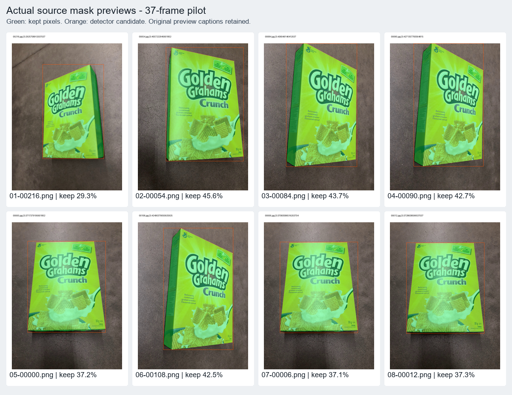
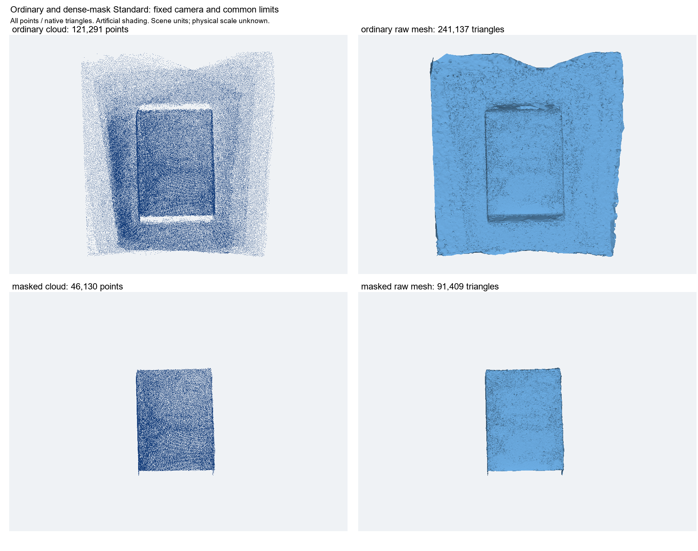
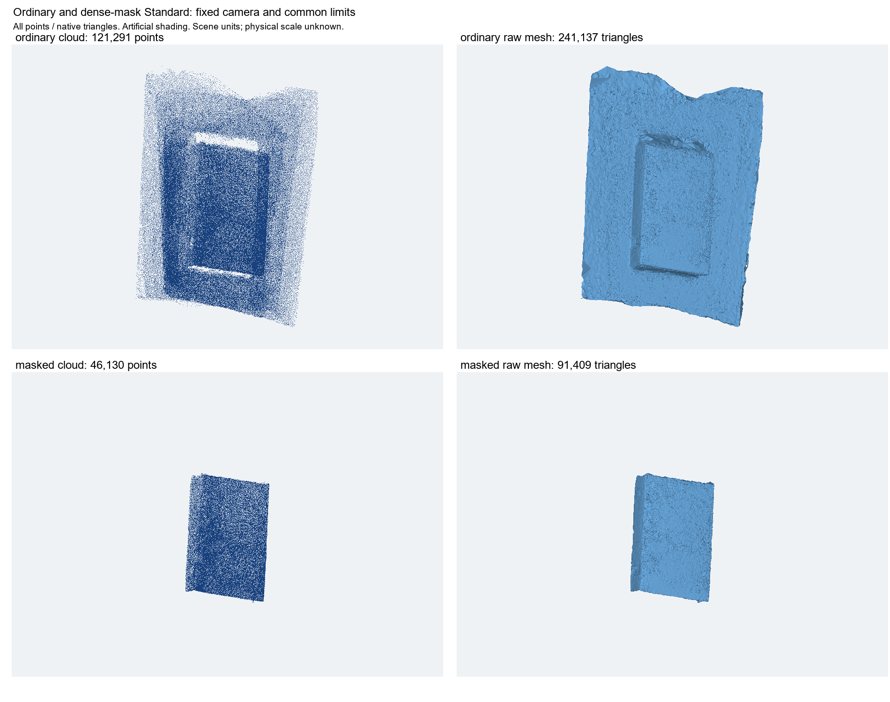
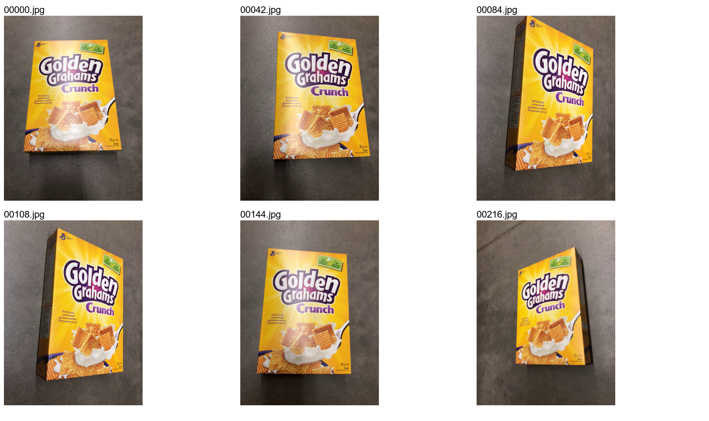

# Автоматические маски → Standard cloud и mesh

22 ноября 2026. [Goal #12](../../goal-12.md), [исходное задание][issue].

Проверенные фотографии и текст объекта теперь дают полный набор PNG через
SAM2.1-small + локальный HF GroundingDINO-tiny, затем штатный Standard создаёт
облако и raw mesh. На сохранённых 37 кадрах коробки маски убрали окружающий пол,
сохранив широкую лицевую поверхность. Боковины и нижние края остаются неполными
и неровными. Это полезное отделение объекта, а не восстановленная замкнутая
CAD-модель или проверка точности изготовления.

Практический путь — [короткая инструкция](../../auto-masks.md).
Независимая итоговая приёмка **PASS R1–R5**; поставка —
[PR #13](https://github.com/Kwentin3/photogrammetry-to-cad/pull/13).

## Что именно сравнивалось

Objectron `cereal_box/batch-3/0`: те же 37 JPEG Goal #6, прежние разрешение,
DSPSIFT normal/normal, DepthMap downscale=2 и maxTCams=10, DepthMapFilter
minNumOfConsistentCams=3, Meshing maxInputPoints=10000000 / maxPoints=1000000.
Материал и происхождение — в [отчёте исходного запуска](../2026-11-21/photo-video-3d.md).
Все JPEG и baseline EXR повторно сверены по SHA с принятым backup.

Использованы все 37 кадров вместо нового subset: сохраняются перекрытие, ракурсы
и точно совпадающий принятый обычный расчёт. Новый subset потребовал бы нового
baseline. Камера движется вокруг неподвижной коробки; **маски применены только
к dense**, `features=false`. Фон помогает SfM. Другие параметры не менялись.
Реальное сравнение не квалифицирует Legacy, поворотный стол или две стороны.

Baseline — сохранённый Standard Goal #6. Полный новый граф содержит 18 native
узлов; SDK подтвердил равенство всех 11 upstream UID и изменение четырёх dense
UID. Native planner назначил ExportImages → DepthMap → DepthMapFilter → Meshing,
без повторного SfM. 37 view IDs, 37 pose IDs и калибровка совпали; максимальная
численная разница в сравненных полях камер и target dense cameras — **0**
(проверка с абсолютным допуском 1e-12).

## Настоящая генерация и просмотр

Конфиг вне Git: `prompt="cereal box."`, `selection="single"`, box threshold=0.3,
text threshold=0.25, device=cuda. Под другую съёмку/объект меняются эти данные,
пути и manifest; исходники генератора не меняются.

Получены **37/37** исходного размера grayscale PNG, только 0/255. В каждом кадре
ровно один DINO candidate, неоднозначностей и failed frames — 0. Сохранённая доля
исходных пикселей — 29.26–45.57%. Настройки, модели, source SHA, actual API/runtime,
bbox, SAM scores, времена, память и previews связаны в `mask-diagnostics.json`.
Native reader затем заново проверил 37 PNG и привязал их к actual CameraInit IDs.

Просмотрены все восемь наложений, дополнительно оригиналы спорных кадров:

- Выбрана коробка Golden Grahams; крупного захвата пола/тени или потери широкой
  лицевой панели в просмотренных кадрах нет.
- В `00000`, `00006`, `00012` частично исключена узкая тёмная нижняя физическая
  грань. Ошибка выделения сохранена и учтена, а не исправлена для красивого результата.
- `00084`/`00090` касаются верхнего края: этот угол уже обрезан в исходных JPEG.
- Минимальная и максимальная площади соответствуют ракурсу/размеру коробки.
  Confidence и площадь сами по себе не использовались как доказательство семантики.

Ручных правок масок, bbox и исключённых кадров — **0**. Выполнен один prompt/run
после one-frame smoke; человек не размечал каждый кадр. Это выборочный визуальный
контроль, не доказательство pixel-perfect контура всех 37 изображений.

SAM2 CUDA extension штатно отключён. `max_hole_area=0`, `max_sprinkle_area=0`:
мелкие дырки/пятна автоматически не очищались. Нативная dynamic-multimask stability
осталась включённой. Отсутствие hole cleanup нельзя считать причиной каждого
краевого дефекта без отдельного опыта; такой опыт в Goal не добавлялся.

## Маски реально дошли до dense

Новые PNG/run сохранены отдельно. Свежий native EXR checker прошёл **37/37**
для обоих вариантов: маршруты, метаданные проекций, размеры RGBA, finite values,
полнота и SHA. В baseline alpha=1 везде. В новых EXR alpha=0 для 54.16–70.42%
пикселей; RGB на полностью opaque пикселях совпал с baseline **точно**.
Это сравнение на одинаковой native target scene и исходниках вместе с actual
mask binding/command line подтверждает применение внешних масок. Alpha одного
произвольного EXR без такого контроля этого бы не доказывала.

PNG и EXR не сравнивались как одинаковые raster: native undistortion/remapping
преобразует координаты. В backup сохранены четыре actual native alpha preview.
После ExportImages штатный planner оставил только три MVS-узла. Их native
команды/status/log и новые каталоги UID сохранены; owned cleanup подтверждён.

## Облако и сетка в одних ракурсах

| Фактически прочитано | Обычный Standard | Dense-маски |
|---|---:|---:|
| Точки PLY | 121291 | 46130 |
| Вершины исходного OBJ | 121293 | 46130 |
| Треугольники исходного OBJ | 241137 | 91409 |

Open3D 0.20.0 прочитал оба PLY и оба OBJ: координаты конечны, индексы допустимы,
все native faces сохранены. При импорте совпадающие OBJ-вершины объединяются
(118788 / 44883 imported vertices); это не потеря граней. SHA нового cloud/mesh
совпали с полным backup, mesh также связан с `mesh_export` в effective settings.

Все точки/треугольники показаны без выборочной обрезки, с общими границами,
камерой и началом координат для четырёх панелей. Нативный OBJ приведён к осям
PLY только в памяти через принятое `diag(1,-1,-1)`; исходные файлы не преобразованы.
Синий цвет/затенение — средство просмотра, текстуры не вычислялись.

Большая окружающая поверхность пола исчезла; широкая лицевая поверхность коробки
сохранилась в обоих рассмотренных видах. Боковая геометрия частичная и грубая,
внизу видны неровные края/маленькие выступы. Большого разрыва лицевой панели на
этой обзорной детализации не видно. Скрытая сторона, толщина, замкнутость и
площадь точно сохранённой поверхности не подтверждены. Число точек не служит
метрикой улучшения, а уменьшение числа граней не доказывает рост точности.

## Окружение, время и деньги

Отдельный Linux Python **3.12.3**, torch **2.5.1+cu124**, torchvision **0.20.1+cu124**,
transformers **4.51.3**; 47 hash-pinned зависимостей, исходник SAM2
`2b90b9f5ceec907a1c18123530e92e794ad901a4`. Локальные модели и source archive
сверены по [manifest](../../../configs/auto-mask-models.json).
Базовый Python Meshroom и его bootstrap не менялись; inference работает через
отдельный subprocess/env. HF local-files-only, safetensors и отключённые custom
kernels проверены реальным запуском; дополнительная компиляция ядер не выполнялась.

AV/Meshroom — прежний [закреплённый runtime](../../../configs/runtime-2026.json).
Одна RTX3090 24576 MiB, driver 580.178.04, CUDA runtime image Ubuntu 24.04;
2 CPU threads для ML, 8 для AV. Локальные команды — общий Windows Job/лимиты;
на ноде — existing remote_job + абсолютный watchdog. Повторы не обнуляли срок.

| Отдельно измеренный этап | Время |
|---|---:|
| Загрузка образа до доступного SSH/watchdog | около 11 минут |
| Системная настройка ноды | 31 s |
| HTTP assets на ноде, native aria2 с SHA | 76 s |
| Отдельный offline ML bootstrap | 73.62 s |
| Runtime bootstrap из сохранённого архива | 16.39 s |
| One-frame inference через actual adapter | 7.75 s |
| Полный generator: validation/load/37 frames/previews | 21.90 s |
| Только обработка 37 кадров внутри generator | 13.75 s |
| Native ExportImages, без следующего QA | 14.36 s |
| DepthMap → DepthMapFilter → Meshing | 73.98 s; 75 s с owner/verify |
| Финальный export, без следующего QA | 1.18 s |

Этапы частично перекрываются, их сумма не равна сроку аренды. К этому добавились
подготовка, диагностика UID, QA, передача и backup. Переиспользованный baseline
получен раньше на другой ноде; ускорение MVS относительно него здесь не измерено.

ML peak RSS **1858478080 B**, Torch peak allocated **2190115840 B**, reserved
**2361393152 B**. NVML sampling 1 s: ML peak 2576 MiB, MVS peak 3966 MiB;
короткий пик между сэмплами мог не попасть в CSV. GNU time maximum RSS MVS —
**834796 KiB**, ML bootstrap — 545996 KiB. Это показания конкретных инструментов,
не размер весов и не измерение суммарной физической RAM всех процессов.

Крупная передача runtime/baseline: 64 MiB части, 8 файлов × 4 потока, SHA частей
и целого; **1119892031 B за 469.75 s**, средняя 2.27 MiB/s. Первый профиль одного
архива с настроенными потоками дал около 0.6 MiB/s: его адресно отменили,
подтвердили cleanup и закрытие SFTP, затем сменили профиль. Backup тем же способом:
1023161968 B, средняя 2.44 MiB/s с проверкой/сборкой. Model/wheel HTTP — native aria2
с 8 соединениями на крупный файл и параллельной загрузкой файлов. Codeload SAM
source отвергал Range; конкретная ошибка и fallback сохранены в логах. Для повторения
есть уже проверенная постоянная копия source, повторять этот сетевой запрос не нужно.

Владелец разрешил ≤$0.60/h, ≤2h от первой ноды, ≤$5 вместе с диском/трафиком.
Ставка с диском около $0.219/h, одна аренда 11:01:48–12:03:17 UTC
(61 min 29 s, срок отсчитан до provider create response). Нода **удалена**,
all-pages absence подтверждён. Актуальный native ledger после удаления: **$0.255**,
в том числе GPU $0.135, диск $0.078, входящий трафик $0.038, исходящий $0.004.
Первый post-delete снимок был $0.243; он сохранён отдельно, провайдер позднее
дописал начисления. Отчёт отражает обновлённую выписку, не обещание итогового invoice.
Provider округляет агрегированные строки до $0.001; это показания ledger,
а не расчёт только по объявленной ставке.

## Сохранение и воспроизводимость

Постоянная частная папка владельца `photogrammetry-to-cad-work/issue-12/`:
проверенные веса/wheelhouse/SAM source, source archive, карточка lifecycle,
исходники/настройки/маски, actual диагностические отчёты, native графы/cache,
cloud/mesh, logs/status и sampler/resources. Большие файлы и доступы вне Git.

Полный result backup **1023161968 B**, 725 payload-файлов / 1151931387 B.
SHA256 `1fe1bcde355bbbb0bdcf858d797bfe022e27ea8c30fd921534d96bc962662752`.
Все части, архив и каждый payload SHA проверены локально до удаления ноды.
`backup/verification.json`, `backup/extracted/backup-index.json`,
`geometry-evidence.json`, `cloud-close/charges-summary.json` — точки проверки.
Модели/wheelhouse/runtime повторно в result archive не включены: их полные
SHA-проверенные копии уже сохранены у владельца, версии/manifest присутствуют.

Две значимые ошибки оставлены в evidence. Упаковка mtime=0 изменила заново
сгенерированные native view IDs: AV использует [fallback mtime][uid], а исходные
JPEG не имеют временных metadata. Первый prepare отклонён до MVS. Новый полный
граф сохранил CameraInit inputs принятого проекта, после чего SDK пересчитал UID,
native reader обновил binding и planner подтвердил только dense-ветку. UID/status
кэша вручную не назначались, ядра не патчились. Первая попытка export без
обязательного scale-plan остановилась до выдачи; штатный `scale` с mode=unknown
устранил пропуск команды, не меняя геометрию.

70 локальных unittest PASS до аренды; реальные GPU/import/inference/native-output
проверки выполнены отдельно. Генератор/adapter, исполнявшиеся на ноде, имеют SHA
`81c4faf7995e460fde89d869f01a871c16c3a215301eda9ba9ee8d8aed94fba4` и
`be97b9239017270606f351a297e92b8cbb1bb0c9b2e3650a150673bc498635b0`.
Проверенная подготовка — commit `1f768b4`; source archive SHA и полный inventory
зафиксированы в частном `preparation-verification.json`. Итоговая документация
добавлена после запуска; runtime-код с тех пор не изменялся.

Включать эту насадку имеет смысл при ненужном фоне и понятном объекте, после
просмотра контуров. Для обычного запуска оставить `masks: null`; ML не импортируется.
Физический масштаб этого набора неизвестен. Полнота деталей/CAD, изготовление,
Legacy/Turntable/TwoSides, другие модели/матчеры в эту приёмку не входят.

[issue]: https://github.com/Kwentin3/photogrammetry-to-cad/issues/12
[uid]: https://github.com/alicevision/AliceVision/blob/d012d05589b528dcf57a2a0c805c0a5709df8613/src/aliceVision/sfmData/uid.cpp#L56
