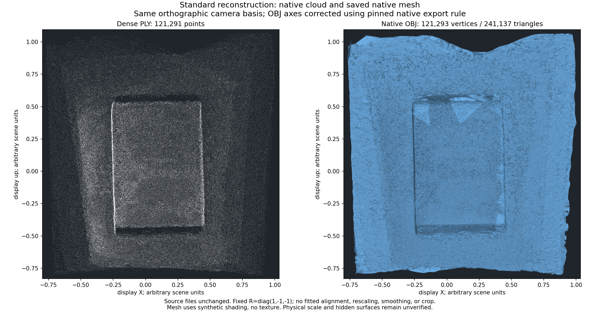

# Фото/видео → облако и mesh: аудит harness

Пользователь может сохранить и открыть **оба самостоятельных результата**
Meshing: плотное облако и исходную сетку, выбрать штатный сценарий по
[карте возможностей](../../meshroom-modes.md) и продолжить полный граф до нужного
узла. Это фотограмметрический результат, без обещания CAD или точности изготовления.
Текущая запись задачи и приёмки — [Goal #8](../../goal-8.md).

## Что фактически прочитано

Использован неизменённый backup принятого Goal #6. Ни фотограмметрия, ни
фильтрация/текстурирование заново не вычислялись; расходы на инфраструктуру $0.
Mesh найден по сохранённому Meshing_1, его native UID/outputMesh/type и
backup-index, а не выбран произвольно. Фактический формат обоих файлов —
текстовый OBJ с вершинами/треугольниками, без MTL, текстур или нормалей.

| Выход | Standard | Legacy |
|---|---:|---:|
| Dense PLY, точки | 121291 | 121513 |
| Native OBJ, строки vertices | 121293 | 121513 |
| Native OBJ, треугольники | 241137 | 241387 |
| Open3D, загруженные vertices | 118788 | 119022 |
| Open3D, загруженные треугольники | 241137 | 241387 |
| Физический масштаб | unknown | unknown |

Open3D 0.20.0 действительно прочитал оба mesh/cloud; координаты конечны,
индексы граней допустимы. Разница счётчиков vertices объясняется совпадающими
координатами: Open3D объединяет их при импорте OBJ, все faces сохранены.
Это не число потерянных или невосстановленных поверхностей.
SHA всех исходных файлов совпали с принятым backup-index до и после проверки.
Точные относительные пути, bytes/SHA и численные проверки —
[JSON результатов](meshroom-harness-results.json). Локальный корень backup
передаётся отдельно; исходные mesh/cloud не коммитятся.

## Оси и масштаб

Native OBJ и экспортированный SfMData PLY имеют **разные оси хранения**.
[Mesh::save](https://github.com/alicevision/AliceVision/blob/d012d05589b528dcf57a2a0c805c0a5709df8613/src/aliceVision/mesh/Mesh.cpp#L135)
пишет `(x,-y,-z)`, а
[SfMData PLY writer](https://github.com/alicevision/AliceVision/blob/d012d05589b528dcf57a2a0c805c0a5709df8613/src/aliceVision/sfmDataIO/plyIO.cpp#L92)
пишет landmark XYZ. Поэтому OBJ → cloud — фиксированное вращение
`R=diag(1,-1,-1)`, translation0, scale1. Оно не подбиралось по геометрии,
не выпрямляет детали и не задаёт физические единицы.

После применения этого R **только в памяти** dense→native mesh vertices
nearest-neighbour max равен 6.94e-6 / 8.49e-6 условных единиц; bbox отличаются
не более 4.6e-7 / 3.34e-6. У Standard две дополнительные native mesh вершины:
обратное mesh→dense max достигает 0.204. Равенство множеств точек не заявляется.
Это согласованность вывода и округления, не оценка точности съёмки.
Оригинальные файлы не поворачивались и не переписывались.

Слева все dense точки, справа все исходные треугольники; один orthographic camera
basis из прежнего просмотра, фиксированный R по native контракту, без fit,
сглаживания, обрезки или decimation. Искусственное shading показывает поверхность,
не фотографическую текстуру. Видны коробка и пол/фон; триангуляция заполняет часть
промежутков между точками, что не доказывает наблюдение этих поверхностей.
Скрытые стороны, нужный объект целиком и физическая точность не подтверждены.

## Какие пробелы закрывает дельта

- Сохранён полный native шаблон: убрано явное удаление MeshFiltering/Texturing/
  CopyFiles и задано `keepOutputNodes=True` (сам native API иначе удаляет output
  nodes). Глубину задаёт `--toNode`, реальные имена доступны в result_nodes.
- `export` сохраняет настоящий Meshing.outputMesh рядом с PLY без нового
  результата-селектора или построения поверхности из точек. Сохраняются native
  source path, bytes и SHA; повторная запись существующего результата запрещена.
  Для glTF сохраняется весь native UID-каталог с соседними buffers; это проверено
  локальной file-bundle fixture, не новым native glTF расчётом.
- Report принимает необязательный `--mesh`, действительно читает сетку и
  проверяет геометрию/индексы/хэш binding. Он явно отражает OBJ rotation и units,
  сохраняя прежний cloud-only вызов. Для других форматов reader/frame не
  квалифицированы. Windows OBJ Unicode-path ограничение обходится чтением native
  basename в его каталоге с обязательным восстановлением cwd.
- Новый RUN может явно использовать native cache через `prepare --cache` для
  последовательной работы с изменёнными настройками. Неизменяемые входы,
  проверка verify, native UID и запрет конфликтующих запусков остаются обязательны.
- Явные настройки SfMTransform у Standard больше не затираются identity default;
  без них прежний путь сохранён. Это проверка передачи native параметров,
  не новый выполненный orientation расчёт или измеренная вертикаль.
- Карта охватывает весь релевантный домен; остальные 22 из 27 шаблонов сведены
  в компактный перечень. Стол/переворот/ML/умный отбор не объявлены вычисленными.

## Продолжение и граница проверки

На реальном закреплённом Python core Meshroom (STANDALONE) в приватные копии
проектов возвращены штатные три downstream узла. После native save/load старые
UID сохранились: Standard15/15, Legacy9/9; Meshing прочитал настоящий SUCCESS.
Native dfsToProcess для Standard планировал: Meshing — пусто, MeshFiltering —
только filtering, Texturing — filtering+texturing. Legacy для Texturing ещё
планировал PrepareDenseScene, но не SfM/DepthMap/Meshing.

Это фактическая проверка core planner, не исполнение AV. Строгий runtime на
Windows ограничен отсутствующим Linux pyalicevision; часть upstream узлов была
загружена native CompatibilityNode, без подмены библиотек. Неизменность UID,
SUCCESS pruning и рецепт --toNode подтверждены; filtering/texturing не запускались.
Полный cache/output и корректные статусы нужны отдельно: SUCCESS сам по себе не
проверяет, что пользователь не удалил файл. Старые урезанные проекты #6 не
превращаются автоматически в новые полные проекты.

## Проверка другим агентом без истории чата

Агент получил только repo, три коротких запроса и отдельно пути к данным/готовой
Python среде. Он нашёл Standard по карте и выполнил доступный локальный путь:
сохранил проверенную пару файлов, запустил cloud-only report и report с --mesh.
Получены 37/37 камер, 121291 point, 118788 loaded vertices/241137 triangles,
unknown units и bbox delta 4.6356e-7 после fixed native R. Исходные bytes/SHA
сверены; Linux settings не переписывались.

Агент открыл собственные виды геометрии и шесть исходных кадров из manifest,
подтвердил коробку/часть боковой поверхности/пол, пропуски в облаке, крупные
закрывающие треугольники и тонкие выступающие фрагменты mesh. Дно/обратная сторона
и точность остались неизвестны. Для третьего запроса он выбрал конкретный
photogrammetryObjectTwoSides, адресные CameraInit_1/2, from_landmarks и конечный
Meshing_3; назвал данные/дополнение и ограничение PDS helper `_1` против `_3`.
Этот сценарий не исполнялся и не выдан за готовый запуск.

Выявленный пробел инструкции — отсутствие конкретной команды обзора — устранён
штатным Open3D GUI-рецептом в runbook. Во время headless теста preview пришлось
подготовить приватно; новый GUI-рецепт здесь не запускался. Для сравнения кадров
нужен исходный capture в backup, а не только маленький пакет cloud/mesh: это
явно указано в backup и локальном просмотре. Приватные audit-result, два report,
handoff SHA и visual evidence сохранены в `issue-8/blind-user` у владельца.

52 unittest и независимая локальная приёмка всего контракта — **PASS**. Ревьюер
самостоятельно прочитал реальную пару актуальным report и сверил доказательства.
Публикация и её точная идентичность фиксируются в Goal #8 отдельно.
