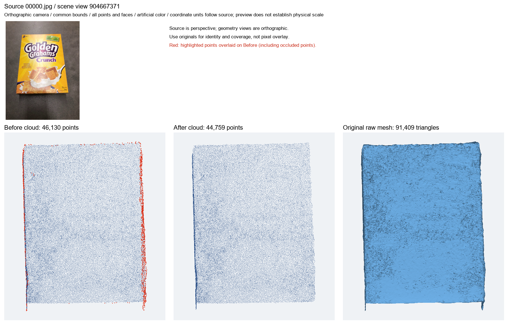
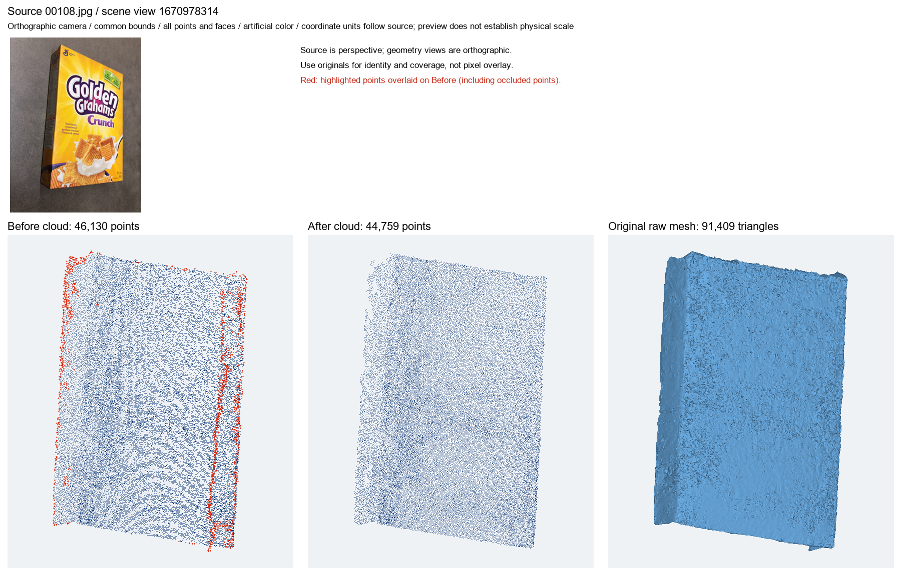

# Реальная геометрия и одна итерация — Goal #15

Теперь агент может повторяемо открыть настоящее облако и mesh вместе с кадрами
через [короткий рецепт](../../geometry-review.md). На сохранённой съёмке #6/#12
выполнена локальная содержательная итерация: штатная статистическая фильтрация
masked cloud. **Кандидат отклонён; исходные cloud/mesh #12 оставлены.**

## Что проверяли и почему

В исходниках Objectron `cereal_box/batch-1/1` видна настоящая левая боковина,
нижние углы и широкая лицевая поверхность. На реальном masked cloud/mesh #12
лицевая поверхность присутствует, боковая восстановлена частично, ниже нижнего
края видны узкие выступы. Это наблюдаемые особенности, а не измеренная ошибка.
Открыты исходный кадр `00108.jpg`, общий контакт #12, preview маски `00084.jpg`
и оба новых сопоставимых вида. Маска на просмотренном `00084` включает видимую
боковину; утверждать, что все пропуски вызваны масками, оснований нет.

Гипотеза: разреженные выступы можно убрать штатной фильтрацией cloud, не трогая
сохранившиеся координаты. Рассмотрен также штатный
[анализ связных компонентов mesh](https://www.open3d.org/docs/release/tutorial/geometry/mesh.html#connected-components):
реальный OBJ имеет **один компонент, 91409 треугольников**. Сохранение largest
component ничего бы не изменило. Проверка Open3D обнаружила non-manifold edges
и vertices; эти свойства не использованы как повод автоматически чинить/закрывать
поверхность. Неполные боковины и скрытые стороны фильтр восстановить не может.

Выбрана одна операция
[`PointCloud.remove_statistical_outlier`](https://www.open3d.org/docs/release/tutorial/geometry/pointcloud_outlier_removal.html),
`nb_neighbors=20`, `std_ratio=2.0`. Она анализирует локальную плотность, не узнаёт
«настоящую коробку». Поэтому обязательны проверка удалённых точек и исходники.
Smoothing, назначение прямых углов, достройка и новая реконструкция не выполнялись.

## Сопоставление и решение

В каждом виде камера и границы общие для панелей; включены все точки и faces.
Красным отмечены удалённые точки поверх Before, включая закрытые другими точками.
Mesh справа — **исходный**, а не результат фильтрации облака. Перспективный
исходник сверху и ортографическая геометрия не являются пиксельным overlay.

| Проверено на реальных файлах | Результат |
|---|---:|
| Исходный masked cloud #12 | 46130 точек |
| Кандидат после SOR | 44759 точек |
| Удалено в отдельный PLY | 1371 точка, 2.97% |
| Координаты оставшихся точек | Точное подмножество оригинала в памяти и после чтения сохранённого PLY |
| Исходный OBJ | 44883 импортированных вершин / 91409 треугольников |
| Исходные cloud/mesh после просмотра | SHA без изменения |

Фронтальный вид показывает удаление правого нижнего разреженного выступа;
левый нижний выступ остаётся. Косой вид и красное выделение показывают удаление
точек также у уже неполной левой боковины и верхнего левого угла. Фильтр не
отделил сомнительный выступ от полезной разреженной геометрии. Уменьшение числа
точек не является улучшением полноты или точности. **Кандидат не принят**, исходный
результат остаётся рабочим. Второй подбор параметров не выполнялся: конкретная
проверяемая гипотеза исчерпана, физическая истинность этих краёв неизвестна.

Для следующей реальной съёмки: доснять обе узкие боковины и нижние углы отдельной
полосой резких кадров с плавным смещением и перекрытием, сохраняя на каждом кадре
часть уже снятой лицевой панели. Добавить более низкие косые ракурсы, чтобы нижний
край не скрывался за лицевой поверхностью; не двигать предмет относительно меток.
Если требуется нижняя/обратная сторона, заранее выбрать сценарий переворота и
привязку меток по capture/modes. Сначала проверить несколько кадров и контуры
масок, затем пересчитать нужные стадии. Это задание оператору, не выполненный
досъём и не подтверждение улучшения 3D.

## Идентичность, ресурсы и повторение

Использована сохранённая база #6/#12, без GPU и новых расходов. Open3D **0.20.0**;
native OBJ → PLY display axes `diag(1,-1,-1)` только в памяти. Native Open3D reader
сливает совпадающие OBJ vertices, все faces сохранены. Камеры `00000` / `00108`
взяты из совпадающей Standard scene #6; значения и SHA записаны в evidence.
Код предпросмотра — `scripts/inspect_geometry.py`; его точный SHA сохраняется
при каждом запуске. Ранее созданные файлы и кадры не изменены.

| Файл | SHA256 |
|---|---|
| Original masked cloud | `491b1f71f7d39aabbcf7ccdad608ab77a6018ec42a6b432800b6ad8e9d3aae47` |
| Original masked mesh | `ac49a52efd25a379fd9d56857c7245bb2fa57abd69dbebf63b699fc0e1a9cebe` |
| Cloud-кандидат | `24ace3cc2e53017960452f3eec9f9f2cbf3aaf47a6915278baa8475cf23edb02` |
| Удалённые точки | `b151d8b6dca4c8793773224caacc735e93f62d6721bd9b2b4d9bd54c751b2171` |

Частные файлы владельца: `photogrammetry-to-cad-work/issue-15/iteration/`:
`filter-cloud.py`, `filter-evidence.json`, `candidate-cloud.ply`, `removed-cloud.ply`,
`probe.py`, `probe.json`, `geometry-evidence.json`, `visual-review.json`.
Исходники остаются в `issue-12/quicklook/run/masked-02/`; frames/scene —
`issue-6/backup/extracted/run/`. Полная связь с проектом и backup — в сохранённом
`issue-12/geometry-evidence.json`; новые SHA повторно сверены с ним.
Native параметры, версия, скрипты, source/settings SHA и отрицательное решение
сохранены; оригинал служит вариантом «до» и не перезаписывался.

Для точного повторения на текущей машине используйте существующий Python
`issue-2/venv/Scripts/python.exe`. Сначала выполните private `filter-cloud.py`
под исполнителем с лимитом 120 s, затем вызов из [рецепта](../../geometry-review.md)
с masked cloud/mesh, Standard `scene.json`, frames и двумя указанными view.
Добавьте `--compare-cloud candidate-cloud.ply --highlight-cloud removed-cloud.ply`,
output/evidence направьте в новый частный каталог. На другом наборе сначала
проверьте мотив для фильтра; переносить параметры автоматически нельзя.

Локальные запуски: managed Windows executor, 2 GiB/32 процесса, один heavy,
2 CPU threads; topology probe 2.6 s, SOR + первые два PNG 5.6 s, окончательный
render с выделением удалённых точек 4.2 s; повтор после нейтральной подписи масштаба
4.1 s (SOR не повторялся). Деревья завершены,
cleanup confirmed. Отдельные полезные результаты и диагностика сохранены вне Git;
новых сервисов, инстансов и фонов нет. Реальный mesh не пересчитывался; физический
масштаб, изготовительная точность, скрытые поверхности и CAD не проверены.
