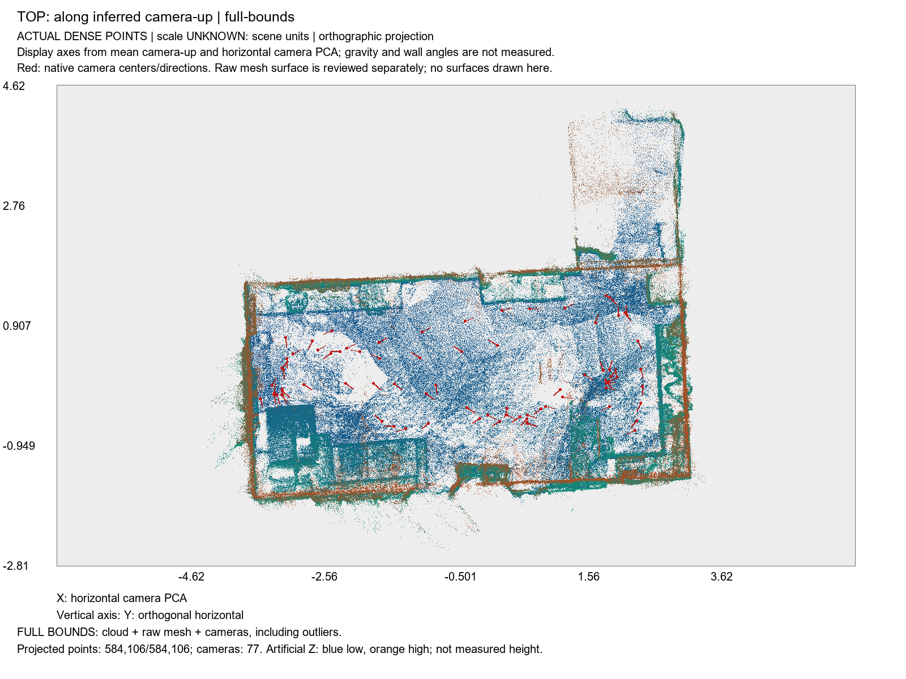
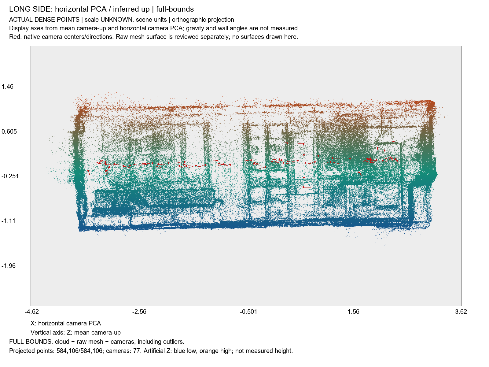
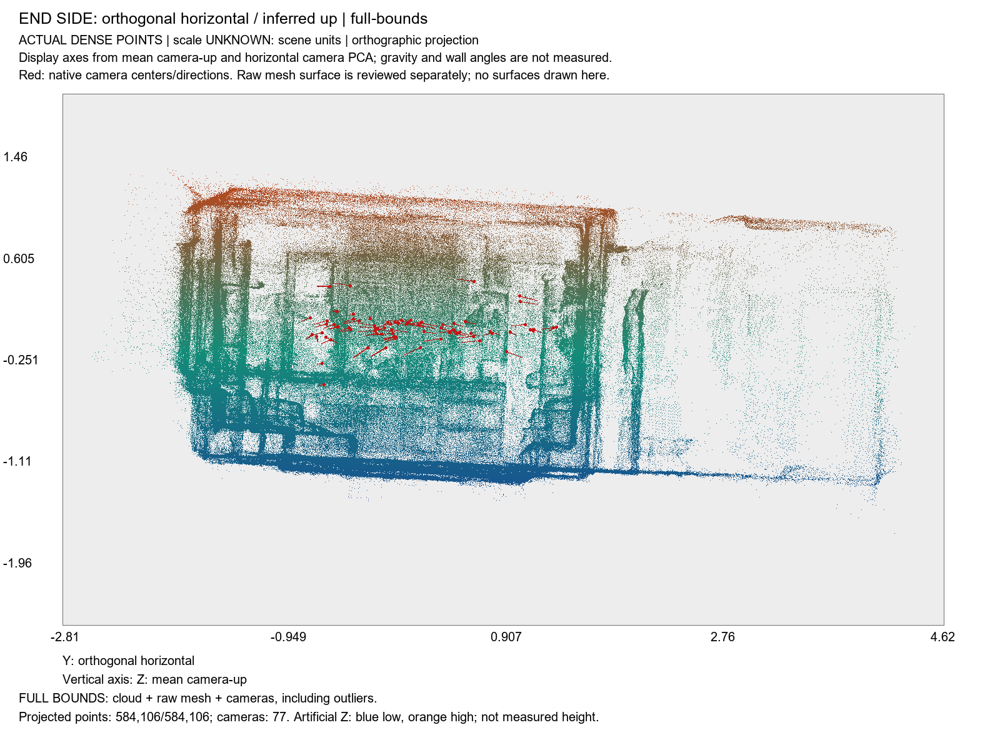

# Goal #27: комната из 77 фотографий

Пользователь получил связанную 3D-сцену основной комнаты, кухни и входной ветви,
открываемые облако и исходную сетку, обзор сверху и боковые виды.
**Результат для обмеров — PARTIAL:** общая форма читается, но сплошность плоскостей,
ровность поверхностей и точные контуры проёмов не подтверждены.
Физический масштаб неизвестен; CAD и точность изготовления не проверялись.

Все 77 камер зарегистрированы. Итог: **584106 точек**, **572228 вершин /
1163039 треугольников raw mesh**. Независимый визуальный осмотр подтвердил
частичный статус. Backup проверен до удаления GPU; аренда освобождена.
Текущий native ledger на 26 ноября 2026, 09:17 UTC — **$0.252 из разрешённых $3**.
Основание и границы задания — [issue #27](https://github.com/Kwentin3/photogrammetry-to-cad/issues/27).

## Вход и выбор маршрута

| Параметр | Проверенный факт |
|---|---|
| Материал | 77 оригинальных JPEG владельца, съёмка 26 ноября 2026 |
| Размер | 242777962 байта; все файлы декодированы, SHA каждого сохранён |
| Изображения | Все 4160×3120, горизонтальные 4:3; точных дубликатов нет |
| EXIF | HUAWEI / HUAWEI Mate 50; 1.95 мм, эквивалент 13 мм, f/2.2 |
| Выдержка / ISO | Примерно 0.001539–0.033446 с / 50–320 |
| Неполные metadata | LensModel и DigitalZoomRatio отсутствуют; внутренние коррекции/кроп этим не исключены |
| Масштаб | CCTag и измеренная база не использовались; unknown |
| Маршрут | Один Standard; DSPSIFT normal/normal, 20000 features на изображение |
| Сопоставление | Native шаблон выбрал Exhaustive: все 2926 пар, ANN_L2 / ACRANSAC / fundamental_matrix |
| Dense | Native ExportImages, проверка всех 77 EXR, DepthMap downscale 2 |
| Meshing | maxInputPoints 10000000, maxPoints 1000000; endpoint Meshing |
| Маски / дополнительные стадии | Маски отключены; MeshFiltering и Texturing не вычислялись |

Набор повторно сверен перед арендой: имена, размеры и SHA всех 77 файлов совпали
с подготовленным manifest. Просмотрены четыре контактных листа и исходники,
включая 1:1 фрагменты шести фото. Видны обход помещения, смена высоты, общие
детали, стены, окна, дверь и кухня. Замечены засветка от солнца, тёмные участки
кухни, мягкая мелкая фактура, однотонный потолок и закрытый мебелью низ стен.
GPS в отчёт не извлекался; оригиналы и контактные листы остаются вне Git.

Regular/Smart к готовым фотографиям не применялись. Мебель оставлена для связки
ракурсов; она вошла и в dense. Автоматическое выделение чистой обмерной оболочки
комнаты не выполнялось. CCTag отсутствуют, поэтому оснований обязательного
Legacy-прогона нет.

## Версии и начальная калибровка

Вычислительный код — [a1f5d48](https://github.com/Kwentin3/photogrammetry-to-cad/commit/a1f5d4867002d80ec1065b3694884edccef377fe);
ядра и общий Python-код проекта не изменены. Использованы Meshroom
b12ea8896e7e95cc9911b4ec39c272914e4da726 и AliceVision
d012d05589b528dcf57a2a0c805c0a5709df8613 из принятого полного архива.
SHA runtime: 4ca3cfb0898b8000def4e68d513468a199b948329b63cdb6b257e427d295163b.

Native CameraInit принял все 77 снимков, все с начальным фокусным из metadata,
и создал одну группу pinhole/radialk3. В cameraSensors.db принятого bundle
строки Mate 50/CET-L29 не найдены: сработала
[ветка 35-мм EXIF](https://github.com/alicevision/AliceVision/blob/d012d05589b528dcf57a2a0c805c0a5709df8613/src/aliceVision/sfmData/ImageInfo.cpp#L250).
SensorWidth/FOV вручную не назначались.

| Параметр | CameraInit | После SfM |
|---|---|---|
| focalLength | 1.95 мм | 2.0444590081370704 мм |
| sensorWidth | 5.191993836668145 мм, estimated | Та же оценка |
| distortionParams | 0, 0, 0 | -0.02098916, 0.00904968, -0.00329134 |
| Группы intrinsics | 1 | 1 |

Оценка сенсора получена из EXIF, не измерена физически. LCP-профиля объектива
нет; параметры не заблокированы. Уточнение калибровки и остаточная ошибка
показывают согласование изображений, а не доказанную метрическую точность.

## Ранний sparse и решение о продолжении

Первичный Standard дал **77/77 valid views и 30012 обычных landmarks**.
Последняя native BA-статистика: mean 1.38541 px, median 0.909808 px.
Экспортированы отдельные PLY обычных точек и центров камер из одного
SfMExpanding.output с фактическим describerTypes = dspsift.
Имена и направления камер взяты из JSON той же сцены.

Сначала просмотрены полные проекции: несколько дальних точек сильно расширяли
рамку. Затем сохранены дополнительные виды вокруг камер. Это изменение окна
просмотра, без фильтрации или изменения исходного PLY. Происхождение дальних
точек отдельно не установлено; возможен и фон за окнами.

Основной агент и независимый reviewer осмотрели восемь sparse-PNG и сопоставили
их с оригиналами. Подтверждён связанный охват жилой части, окон, стены с дверью
и кухни; выпавших камер нет. Это обосновало переход к dense. Пол, потолок,
плоскостность стен и геометрия откосов на sparse-этапе ещё не принимались.

Физический масштаб оставлен unknown, SfMTransform — identity. Не вводились
прямые углы, равные сечения, измеренная вертикаль или метрический срез.
Полный native граф сохранён; вычисление ограничено штатным --toNode.

## Что видно в плотной геометрии

Все файлы реально открыты Open3D. Проверены шесть общих проекций и четыре
повторяемых вида cloud/raw mesh рядом с оригинальными фотографиями: диван
и окна, кухня, декоративная стена с дверью и входная ветвь.
Независимый reviewer сверил SHA cloud, mesh и scene у обоих наборов изображений.

| Элемент | Восстановлено и видно | Ограничения для обмеров |
|---|---|---|
| Основная комната и связь с кухней/входом | Общий объём и взаимное положение частей | Размеры, взаимные углы и полнота оболочки не проверены |
| Стена с декоративной панелью и дверной областью | Протяжённая область включена в сцену | Неровная mesh; чистая стеновая плоскость не принята |
| Две оконные стены у дивана | Положение окон и повторяющиеся членения в cloud | Полные контуры, глубина откосов и стекло не приняты |
| Кухонные стены | Кухня связана с комнатой, видны границы и обстановка | Стены за шкафами скрыты; есть крупные заполнения сетки |
| Входная ветвь и дверные проёмы | Ветвь и её положение читаются | Толщина, глубина и точные края проёмов не подтверждены |
| Пол | Есть нижний слой и проходы между объектами | Мебель перекрывает часть пола; непрерывность, плоскостность и все стыки не установлены |
| Потолок и верхние стыки | Верхние границы и отдельные участки cloud | Однотонные поля не подтверждены сплошными наблюдениями |
| Низ стен за диваном, радиаторами, стеллажом | Видимые участки включены | Скрытые поверхности неизвестны |

**У всех строк масштаб неизвестен.** Крупные треугольные заполнения, выступы
и бугристые области raw mesh нельзя принимать за подтверждённые плоскости,
откосы или перемычки. Сплошная «крышка» сетки не доказывает восстановление потолка.
Причины конкретных артефактов — наблюдения, фактура, отражения, калибровка или
параметры meshing — отдельно не изолированы.

Ниже показаны реальные точки, без дорисованных поверхностей. Цвет — координата
вдоль приблизительного верха камер, не текстура и не метрическая высота;
красным — камеры. Ортонормированный поворот только для просмотра рассчитан
по среднему camera-up и горизонтальному PCA камер. Он не меняет форму
и не выпрямляет стены. Гравитация не измерена; единицы остаются единицами сцены.

Увеличенные варианты и четыре вида с исходными фотографиями находятся
в локальной выдаче. Перспективный оригинал и ортографическую геометрию
нельзя сравнивать пиксельным наложением.

## Итерации, исправления и прежнее видео

Выполнен один маршрут реконструкции. Ни потерянной зоны камер, ни непроверенных
пар нет; новой GPU-итерации с конкретной проверяемой гипотезой осмотр не обосновал.
Сглаживание или удаление крупных граней не добавило бы измеренных поверхностей.
Исходные cloud/raw mesh сохранены.

Реальный Linux-прогон выявил два интеграционных нюанса, которых не показал
один синтаксический тест:

- При импорте runtime native OCIO trace попадает в stdout. В примере раннего
  sparse-export значения теперь отделены префиксом SPARSE_EXPORT= и проверяются
  число полей и существование сцены. Исправленный блок реально выполнен.
- В сериализованных inputs тип признака может быть ссылкой
  {FeatureMatching_1.describerTypes}. Первый staging backup остановился на
  ошибочном предположении о готовом списке. После подтверждённого завершения
  его процессов сохранены диагностика и частичный staging; значение прочитано
  через r.load()/native graph API. Второй staging прошёл native чтение обеих сцен.
  Фотограмметрия при этом не пересчитывалась.

Обновлены [runbook](../../runbook.md#оценка-sparse-до-dense),
[памятка оператору](../../operator.md), README, AGENTS, контекст и короткий skill.
Команды не дублируются во всех точках входа; новый оркестратор, стек или патч ядра
не добавлен.

Первое видео дало локальный фрагмент: Standard 16 и Legacy 17 камер из 160
Smart-кадров. [Его отчёт и последующий research](https://github.com/Kwentin3/photogrammetry-to-cad/blob/3c4ab0b9c03f31fb1843242ecb89555b44ae17cb/docs/reports/2026-11-25/room-smart.md)
сохраняют разбор смаза/опорных точек, рекомендации разработчиков и сообщества,
идею неподвижной проекции и поиск б/у проектора. Новый результат не изолирует
причину старой неудачи: в частности, горизонтальная ориентация фото не доказана
как единственная причина улучшения. Печатные метки, измеренная база и проекция
в этом прогоне не испытывались; покупок оборудования не было.

## Сохранность, расходы и выдача

Выбрана одна RTX 3090, VRAM 24 GiB, advertised RAM около 43 GB,
диск 60 GiB, driver 595.99.02; ставка с диском $0.216667/ч.
До create был повторён поиск: первоначальный offer с 64 GB уже исчез.
Новая нода выбрана из свежего shortlist с учётом RAM и трафика.
Доступ к постоянному private runtime-source проверен до аренды; account token
остался на управляющей машине. Runtime скачан самой GPU за 13 с с проверкой SHA.

Владелец отдельно разрешил $3 для #27; бюджет старого видео не переносился.
Аренда: 08:05:00–09:15:38 UTC, 26 ноября 2026. Автоматический stop был armed,
временные задания имели TTL; CPU affinity/OpenMP — 8. Это не обещание ровно
восьми native threads: дополнительные pools наблюдались.
Расчётные деревья завершены, cleanup подтверждён; инстанс удалён,
отсутствие проверено native inventory по всем страницам.
Текущий ledger на 09:17 UTC: **$0.252**, включая относящиеся к инстансу начисления.

Сохранены и проверены **494 payload-файла / 755417000 байт**:
проект, effective settings, признаки, пары, native сцены и mesh, PLY, диагностика.
Все SHA совпали после выгрузки; ещё раз проверены 77 оригиналов.
Сохранены семь фактических USD→USDC ссылок; две сцены прочитаны native конвертером
именно из staging, с 30012 sparse и 584106 dense-точками.
Raw mesh побайтно совпадает с native Meshing.outputMesh.

Исключены 463 файла (5435207279 байт): воспроизводимые EXR и дубликаты
оригиналов/транспортного tar. Исходные JPEG и их проверенный архив сохранены
на управляющей машине. Для полного продолжения dense EXR нужно пересчитать;
одни сохранённые SUCCESS-статусы не гарантируют готовый resume.

Локальная выдача владельца: **D:/Share/Room-photos-20261126/**, начало — README.txt.
В ней открываемые dense.ply и mesh.obj, камеры/настройки, PNG и manifest.
Для совместного просмотра с облаком есть mesh-cloud-axes.ply: только общий
поворот native OBJ diag(1,-1,-1), без фильтрации, сглаживания или смены масштаба;
вершины и индексы треугольников проверены после записи, ошибка roundtrip равна нулю.
Полный backup остаётся вне Git; его путь и SHA-ведомость указаны в локальной выдаче.

В Git опубликованы инструкции, этот отчёт и обезличенные геометрические PNG.
Оригиналы, полные облака/mesh, кэш, частные настройки и доступы не публикуются.
Внешний reviewer получает из Git отчёт и обзоры; повторная проверка исходной
геометрии или физической точности требует отдельного доступа к частной выдаче.

## Следующий полезный шаг

Для перехода к обмерам выбрать один длинный доступный отрезок между узнаваемыми
в сцене концами, измерить его и сфотографировать концы. На другом участке
нужен независимый контрольный размер; масштабная пара сама по себе не проверяет
всю комнату. Не назначать размеры по мебели или правдоподобию.

Если нужны конкретные плоскости пола/потолка — сначала короткая проба открытого
участка и стыков с разнесённых косых ракурсов. При недостатке фактуры проверить
временную матовую фактуру на доступном участке; CCTag не заменяет рисунок всей
плоскости. Для нужного проёма отдельно показать обе стороны откоса, верх
и порог/подоконник с окружающей стеной. Положение двери закрепить на весь проход.
Недоступные поверхности за мебелью оставить неизвестными.

Выполнение и сохранение этого прогона завершены; **PRODUCT PASS для полной
обмерной оболочки не получен**. Новая съёмка, замеры, испытание меток/проекции,
метрическая проверка и CAD — отдельные последующие этапы.
